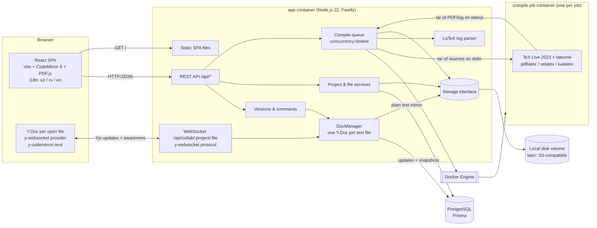
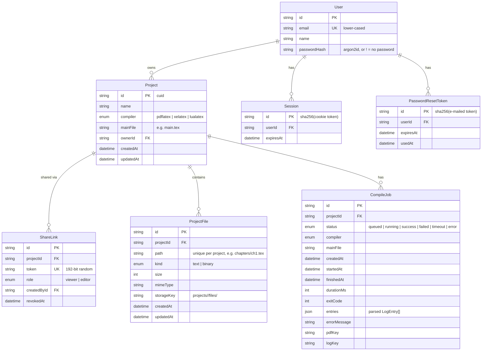
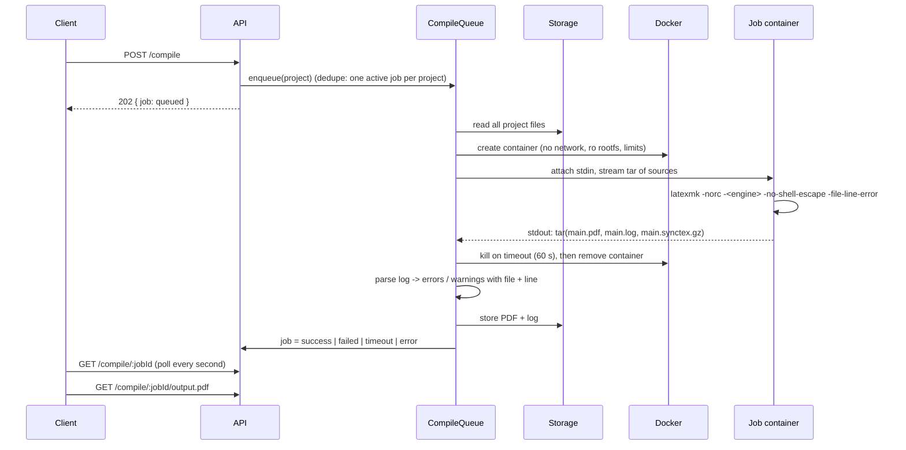

# Oversells — Architecture and Roadmap

Oversells is an online LaTeX editor (in the spirit of Overleaf) built for
educators and educational publishers, with first-class support for Uzbek
(Latin and Cyrillic) textbooks and mathematical content.

This document describes the target architecture for all phases, the details of
Phase 1 (MVP), and the decisions taken along the way.

---

## 1. Architecture overview



### Components

| Component | Technology | Responsibility |
|---|---|---|
| Web client | React 19, Vite, CodeMirror 6 (`stex` mode), pdfjs-dist, i18next | Project list, editor, file tree, PDF preview, error panel, auto-save |
| API server | Node.js 22, Fastify 5, Zod | REST API, validation, serving the built SPA |
| Database | PostgreSQL 16 via Prisma 6 | Projects, file metadata, compile jobs |
| Storage | `Storage` interface; `LocalDiskStorage` implementation | File contents and compile outputs (PDF, log) |
| Compiler | Docker image `oversells-texlive` (Ubuntu 24.04, TeX Live 2023) | Runs latexmk inside a locked-down, throw-away container per job |
| Shared package | `@oversells/shared` (TypeScript) | DTO types, path validation and file-name sanitising shared by client and server |

---

## 2. Data model (Phases 1–2)



* File **contents** never live in the database; the database stores metadata
  and a `storageKey`. Renaming or moving a file is a metadata-only update.
* Folders are implicit (derived from file paths). Empty folders exist only in
  the client until a file is created inside them.
* Templates are not in the database: they are directories under
  `apps/server/templates/<name>/` with a `template.json` (localized title and
  description, compiler, main file). Their preview PNGs are cached in storage
  under `templates/<name>/<content-hash>.png`.
* Phase 3 adds (see `apps/server/prisma/schema.prisma`):
  * `DocUpdate` — Yjs updates of a text file in order; `snapshot=true` rows
    hold a compacted full state that replaced all earlier rows;
  * `Version` — project version (`auto` / `named` / `restore`), with the text
    of all text files as JSON in storage (`projects/<pid>/versions/<vid>.json`);
  * `Comment` — thread root (anchors = encoded Yjs relative positions, quote)
    or reply (`parentId`); `resolvedAt`;
  * `SharedProjectAccess` — "shared with me" (user × share link), deleted when
    the link is revoked.

---

## 3. API (Phases 1–3)

All endpoints are under `/api`. Errors use one shape:
`{ "error": { "code": "file_exists", "message": "..." } }` — the client
translates `code` into the UI language.

| Method | Path | Description |
|---|---|---|
| GET | `/api/health` | Liveness + whether the compiler image is available |
| GET | `/api/auth/me` | Current user (`{ user: null }` if logged out); issues the CSRF cookie |
| POST | `/api/auth/register` | `{ email, password, name? }` → creates account and session (rate limited) |
| POST | `/api/auth/login` | `{ email, password }` → session cookie (rate limited) |
| POST | `/api/auth/logout` | Ends the session |
| POST | `/api/auth/password-reset/request` | `{ email, lang? }` → e-mails a reset link; always `{ ok: true }` (rate limited) |
| POST | `/api/auth/password-reset/confirm` | `{ token, password }` → new password, all sessions ended (rate limited) |
| GET | `/api/templates` | Template gallery (localized titles/descriptions) |
| GET | `/api/templates/:name/preview.png` | First page of the compiled template |
| GET | `/api/share/:token` | Resolve a share link → `{ projectId, projectName, linkRole, role }` |
| GET | `/api/projects` | The caller's own projects (most recently updated first) — login required |
| POST | `/api/projects` | Create project `{ name, template?, compiler? }` — login required |
| GET | `/api/projects/:id` | Project with its file list and the caller's `access` (`owner`/`editor`/`viewer`) |
| PATCH | `/api/projects/:id` | Rename (owner) / change compiler or main file (editor) |
| DELETE | `/api/projects/:id` | Delete project, its files and outputs (owner) |
| GET | `/api/projects/:id/download.zip` | Download the project sources as ZIP |
| GET | `/api/projects/:id/share-links` | Active share links (owner) |
| POST | `/api/projects/:id/share-links` | Create a link `{ role: "viewer" \| "editor" }` (owner) |
| DELETE | `/api/projects/:id/share-links/:linkId` | Revoke a link (owner) |
| POST | `/api/projects/:id/files` | Create a text file `{ path, content? }` |
| POST | `/api/projects/:id/upload?folder=&overwrite=` | Multipart upload (one or more files) |
| GET | `/api/projects/:id/files/:fileId` | Raw file content |
| PUT | `/api/projects/:id/files/:fileId/content` | Save text content `{ content }` (auto-save) |
| PATCH | `/api/projects/:id/files/:fileId` | Rename / move `{ path }` |
| DELETE | `/api/projects/:id/files/:fileId` | Delete file |
| POST | `/api/projects/:id/folders/rename` | Rename / move a folder `{ from, to }` |
| DELETE | `/api/projects/:id/folders?path=` | Delete a folder and everything in it |
| POST | `/api/projects/:id/compile` | Start a compile (`{ wait?: boolean }`); returns the job (202, or 200 when `wait`) |
| GET | `/api/projects/:id/compile/latest` | Latest compile job (`{ job: null }` if never compiled) |
| GET | `/api/projects/:id/compile/:jobId` | Job status, parsed errors/warnings |
| GET | `/api/projects/:id/compile/:jobId/output.pdf` | PDF (`?download=1` for attachment) |
| GET | `/api/projects/:id/compile/:jobId/output.log` | Raw LaTeX log + latexmk output |
| WS | `/api/collab/:id/:fileId[?share=]` | Real-time editing of one text file (y-websocket protocol); viewers read-only |
| GET | `/api/projects/shared` | Projects the user opened through share links ("shared with me") |
| GET | `/api/projects/:id/comments[?fileId=]` | Comment threads with replies and current range (read) |
| POST | `/api/projects/:id/comments` | Start a thread `{ fileId, anchorStart, anchorEnd, body }` (write) |
| POST | `/api/projects/:id/comments/:commentId/replies` | Reply `{ body }` (write) |
| PATCH | `/api/projects/:id/comments/:commentId` | Resolve / reopen `{ resolved }` (write) |
| DELETE | `/api/projects/:id/comments/:commentId` | Delete (author or owner) |
| GET | `/api/projects/:id/versions` | Version list (read) |
| POST | `/api/projects/:id/versions` | Save a named version `{ name }` (write) |
| GET | `/api/projects/:id/versions/current` | Current text of all text files (for diffs) |
| GET | `/api/projects/:id/versions/:versionId` | Text of all files in a version |
| POST | `/api/projects/:id/versions/:versionId/restore` | Restore as a new change (write) |

### Authentication and access rules (Phase 2)

* **Session**: random 256-bit token in the HTTP-only, `SameSite=Lax`
  cookie `oversells_session` (`Secure` with `COOKIE_SECURE=true`); the
  database stores only its SHA-256. 30-day lifetime; logout and password reset
  delete sessions server-side.
* **CSRF**: double-submit cookie. Every API response sets a readable
  `oversells_csrf` cookie if missing; every non-GET API request must echo it
  in `X-CSRF-Token`, otherwise `403 csrf_failed`. Cross-site pages can neither
  read the cookie nor send the header.
* **Passwords**: argon2id (19 MiB, t=2, p=1), 8–200 characters; login failures
  return the same error for unknown e-mail and wrong password, with equal work.
* **Rate limiting**: `AUTH_RATE_LIMIT_MAX` requests per IP per window on
  register, login and both password-reset endpoints → `429 rate_limited`.
* **Access** (checked on every project, file and compile route):

  | Caller | Read files, ZIP, compile, PDF | Edit files, compiler, main file | Rename, delete, share |
  |---|---|---|---|
  | Owner | ✓ | ✓ | ✓ |
  | Logged-in user with an editor link | ✓ | ✓ | 403 |
  | Anonymous user with an editor link | ✓ | 403 | 403 |
  | Anyone with a viewer link | ✓ | 403 | 403 |
  | Anyone else | 404 | 404 | 404 |

  The share token travels in `X-Share-Token` (API calls) or `?share=` (plain
  URLs such as the PDF, ZIP and images, which cannot carry headers).

### Real-time collaboration (Phase 3)

```mermaid
sequenceDiagram
  participant A as Browser A (owner)
  participant S as Server (DocManager)
  participant B as Browser B (editor link)
  participant P as PostgreSQL / storage
  A->>S: WebSocket /api/collab/:p/:f (cookie; Origin checked)
  S->>S: access check → owner (read/write)
  S->>P: load DocUpdate rows (or seed from stored text)
  S-->>A: sync step 1/2 (state), awareness
  B->>S: WebSocket (?share=token) → editor
  A->>S: update (keystrokes)
  S-->>B: update (broadcast)
  S->>P: append DocUpdate (debounced batch); every N batches → one snapshot row
  S->>P: write plain text to storage (debounced) — compile/ZIP read this
```

* **One Y.Doc per text file**, Y.Text named `content`. The server holds a
  document while anyone is connected (plus `COLLAB_UNLOAD_AFTER_MS`).
* **Viewers** connect too (they see live edits and cursors), but the server
  answers only their sync step 1 and drops their sync step 2 / updates.
* **REST writes** (PUT content, upload overwrite, restore) are applied to the
  Y.Doc as a character diff, so connected editors see them live and comment
  anchors survive.
* **Compile and ZIP** flush live documents to storage first.
* **Offline**: the browser keeps editing its Y.Doc; y-websocket reconnects
  with backoff and both sides exchange the missing updates (CRDT merge).
* **Revocation**: revoking a share link closes the WebSocket sessions opened
  with it (close code 4403).
* **Versions**: automatic while editing (at most every
  `AUTO_VERSION_INTERVAL_MS`, default 10 min) and when the last person leaves a
  changed document; identical states are not saved twice. Restoring saves the
  current state first, then applies the old text as a normal change and saves
  a `restore` version — nothing is ever overwritten.

---

## 4. Compile pipeline



### Sandbox per job

Every job runs in a **new** container from `oversells-texlive`:

* `NetworkMode: none` — no network at all.
* `ReadonlyRootfs: true`; writable space only on size-limited tmpfs mounts:
  `/work` (project + outputs, default 512 MB) and `/tmp` (TeX caches).
* `Memory` = `MemorySwap` (default 1 GB), `NanoCpus` (default 1 CPU),
  `PidsLimit` 256.
* `CapDrop: ALL`, `no-new-privileges`, runs as the unprivileged user `tex`
  (uid 1001).
* Wall-clock timeout (default 60 s): the server kills the container.
* `latexmk -norc` (no `latexmkrc` Perl execution), `-no-shell-escape`,
  `openout_any=p` (TeX may not write outside the work dir).
* No bind mounts: sources go in as a tar stream on **stdin**; outputs come back
  as a tar stream on **stdout** (size-capped). This also means the app works
  identically against a local or a remote Docker daemon.
* The container is always removed (`force: true`) after the job.

The server talks to the Docker Engine through `/var/run/docker.sock`. Access to
the socket is equivalent to root on the host — acceptable for a single-machine
deployment; Phase 4 moves compilation into a separate worker service (see
roadmap) so the public-facing app no longer needs the socket.

### Queue

* In-process queue with a global concurrency limit (`COMPILE_CONCURRENCY`,
  default 2).
* At most one active (queued/running) job per project; a second compile
  request returns the active job.
* On start-up, jobs left `queued`/`running` by a previous process are marked
  `error`.
* Only the outputs of the last 5 jobs per project are kept in storage.

### Log parsing

`-file-line-error` produces `./chapters/ch1.tex:12: Undefined control sequence.`
TeX's 79-column line wrapping is disabled in the image (`max_print_line`), so
those lines are parsed reliably. The parser also:

* handles classic `! ...` errors and picks the line from `l.<n>`,
* tracks the `(./file.tex ... )` file stack for warnings,
* extracts `LaTeX/Package ... Warning ... on input line N`,
* reports `Overfull/Underfull \hbox` as "typesetting" entries,
* ignores errors in system files' paths (reports them without a project file).

---

## 5. Folder structure

```
.
├── PLAN.md                 # this document
├── README.md
├── docker-compose.yml      # db + compiler image + app
├── Dockerfile              # app image (builds web + server)
├── .env.example
├── compiler/               # TeX Live sandbox image
│   ├── Dockerfile
│   └── run-latexmk.sh
├── packages/shared/        # @oversells/shared: DTOs, path rules
│   └── src/
├── apps/server/            # @oversells/server: Fastify API
│   ├── prisma/             # schema + migrations
│   ├── templates/          # project templates: textbook, worksheet, exam, article, blank
│   ├── src/
│   │   ├── config.ts
│   │   ├── app.ts          # buildApp(): wires services + routes
│   │   ├── index.ts        # process entry point
│   │   ├── errors.ts
│   │   ├── storage/        # Storage interface + LocalDiskStorage
│   │   ├── projects/       # project service + routes + templates + zip
│   │   ├── files/          # file service + routes
│   │   ├── auth/ access/ share/  # accounts, access rules, share links
│   │   ├── collab/         # DocManager (Yjs), WebSocket route, text diff
│   │   ├── versions/       # version history
│   │   ├── comments/       # comment threads
│   │   └── compile/        # runner interface, DockerRunner, queue, log parser
│   └── test/               # unit tests (vitest) and e2e tests
└── apps/web/               # @oversells/web: React SPA
    ├── src/
    │   ├── api/            # typed API client
    │   ├── collab/         # CollabSession: Y.Doc + provider per open file
    │   ├── i18n/           # uz / ru / en
    │   ├── pages/          # ProjectList, Editor
    │   └── components/     # FileTree, CodeEditor, PdfViewer, LogPanel, ...
    └── e2e/                # Playwright browser test
```

---

## 6. Roadmap and acceptance criteria

### Phase 1 — MVP ✅ done

Scope: single user, no authentication (run locally / on a trusted network).

Acceptance criteria:

1. `docker compose up` starts PostgreSQL, builds the compiler image and the app;
   the UI is reachable on `http://localhost:3000`.
2. The project list supports create, rename and delete; new projects start from
   the Uzbek textbook template.
3. A project contains several files and folders (`.tex`, `.bib`, images, …);
   files can be created, uploaded, renamed/moved and deleted.
4. The editor highlights LaTeX syntax and auto-saves (debounced, with a visible
   saved/saving indicator).
5. "Compile" (or Ctrl/Cmd+Enter) produces a PDF shown side by side with the
   editor; pdfLaTeX / XeLaTeX / LuaLaTeX selectable per project.
6. Compile errors are listed with file and line; clicking one opens that file
   and jumps to the line.
7. The default template compiles without errors with XeLaTeX **and** LuaLaTeX
   and renders Uzbek Latin (oʻ, gʻ, ʼ) and Cyrillic (ў, қ, ғ, ҳ) correctly,
   with amsmath/amssymb/tikz/pgfplots/geometry.
8. The project can be downloaded as ZIP, the PDF can be downloaded.
9. Path traversal, disallowed file types, oversized uploads and dangerous file
   names are rejected; compilation never runs on the host.
10. UI is in Uzbek (Latin) by default and switchable to Russian and English.
11. Unit tests (paths, storage, project/file CRUD, compile queue, log parser)
    and an end-to-end test (create project → compile template → PDF) pass.

### Phase 2 — Accounts, sharing, templates ✅ done

* Email + password accounts (argon2id hashes), HTTP-only session cookies,
  CSRF protection, password reset by email (SMTP config), rate limiting on auth.
* Every project gets an owner; all project routes check access.
* Share links: random tokens with role `viewer` or `editor`, revocable.
* Templates gallery: textbook, worksheet, exam paper, article (each with a
  preview PNG generated by compiling it); "create from template".
* Acceptance: a second user can open a shared link read-only / edit; without a
  link they get 404; template projects compile with zero errors.
* Delivered as: unit tests for auth, CSRF, rate limiting, password reset, the
  full access matrix and share links; API e2e compiling all five templates in
  the sandbox (no errors, no warnings in the final log); Playwright tests for
  register → template → compile and for sharing with a second browser context.

### Phase 3 — Real-time collaboration ✅ done

* Yjs documents per text file, synced over WebSocket (y-websocket protocol in
  the Fastify server), persisted as incremental updates + periodic snapshots in
  PostgreSQL; CodeMirror bound via `y-codemirror.next` with remote cursors.
* Comments anchored to Yjs relative positions; resolve/reopen.
* Version history: named and automatic snapshots, diff view, restore.
* "Shared with me": projects opened through a link, until it is revoked.
* Acceptance: two browsers editing the same file converge; history restore
  works; comments survive edits around them.
* Delivered as: unit tests for WebSocket access (owner/editor/viewer/anonymous/
  stranger/foreign Origin/binary file), live REST saves, offline edits and
  reconnect, awareness, persistence and compaction, versions (auto/named/
  restore), comment anchoring through edits and restores, shared-with-me;
  Playwright test with two browser contexts (concurrent typing, comment,
  history restore).

### Phase 4 — Power features and production

* SyncTeX both directions (the `.synctex.gz` is already produced in Phase 1).
* Spell checking (Hunspell dictionaries incl. Uzbek Latin/Cyrillic, Russian,
  English) in a web worker.
* AI assistance (explain an error, suggest a fix, generate exercises/TikZ),
  behind a feature flag and per-user quota.
* Admin panel (users, quotas, compile statistics).
* Deployment: separate stateless compile workers pulling jobs from a Redis/
  Postgres queue (the app no longer holds the Docker socket), gVisor/rootless
  runtime for jobs, S3-compatible storage (`S3Storage` implementing
  `Storage`), CDN for PDFs, horizontal scaling, backups, observability.
* Acceptance: click in PDF jumps to source and back; load test of N concurrent
  compiles meets the target latency.

---

## 7. Decisions

| # | Decision | Reason |
|---|---|---|
| D1 | Monorepo with npm workspaces (`apps/server`, `apps/web`, `packages/shared`). | One `npm install`, shared types and path rules without publishing packages. |
| D2 | Fastify 5 instead of Express. | Built-in schema/validation hooks, faster, first-class TypeScript and async error handling. |
| D3 | Prisma 6 (not 7). | Prisma 7 requires driver adapters and a new config layout; 6.x is stable and well documented. Upgrade later. |
| D4 | Compiler image based on Ubuntu 24.04 packages (TeX Live 2023) instead of the official `texlive/texlive` image. | ~1.7 GB instead of ~5 GB, reproducible apt install, all required packages present. Can switch to upstream TeX Live later by changing only `compiler/Dockerfile`. |
| D5 | Default font for the template: **Noto Serif / Noto Sans / DejaVu Sans Mono**. | CMU Serif (Computer Modern look) lacks U+02BB (ʻ) in italic, which breaks oʻ/gʻ inside theorems. Noto covers Uzbek Latin and Cyrillic in all styles. CMU and DejaVu are installed too. |
| D6 | Uzbek language via `babel` + `\babelprovide[import=uz-Latn, main]{uzbek}` and `\babelprovide[import=uz-Cyrl]{uzbekcyr}`. | The `uzbek-latin` package options do not exist in TL 2023's babel; the ini-based locales do. There are no Uzbek hyphenation patterns, so the template sets `\emergencystretch`. |
| D7 | New projects default to **XeLaTeX**. pdfLaTeX remains selectable. | fontspec/Unicode fonts are required for ʻ/ʼ and Cyrillic in one document. |
| D8 | No bind mounts for compile jobs; tar over stdin/stdout, tmpfs `/work`. | Works with Docker-in-Docker setups (no host path mapping), size-limited workspace, nothing written to host disk by TeX. |
| D9 | File names restricted to ASCII `[A-Za-z0-9._-]` per segment, no dot-files; uploads are sanitised (Cyrillic transliterated, spaces → `_`). | TeX handles non-ASCII/space file names poorly across engines; dot-file ban also blocks `.latexmkrc`. |
| D10 | Allowed file types: text (`tex, ltx, bib, bst, bbx, cbx, lbx, cls, sty, clo, cfg, def, dtx, ins, ist, tikz, txt, md, csv, tsv, dat`) and binary (`png, jpg, jpeg, pdf, eps, ttf, otf`). SVG is excluded. | SVG needs shell-escape (Inkscape) to be useful and is an XSS vector when served. Fonts are allowed so textbooks can use custom Uzbek fonts. |
| D11 | Limits (configurable): 20 MB per upload, 2 MB per text file, 500 files and 200 MB per project. | Sensible single-user defaults. |
| D12 | Text files must be valid UTF-8 (BOM stripped). | UTF-8 everywhere; invalid files are rejected with a clear message instead of silently corrupting text. |
| D13 | Compile API is asynchronous (202 + polling); `{ wait: true }` is available for scripts/tests. | Keeps HTTP requests short and maps naturally onto a worker queue in Phase 4. |
| D14 | Phase 1 has no authentication. | Explicitly out of scope; the README warns not to expose Phase 1 to the internet. |
| D15 | Upload of an existing path fails with 409 unless `overwrite=true`; the UI asks the user. | Avoids silent data loss. |
| D16 | Raw files are served with `X-Content-Type-Options: nosniff` and `Content-Security-Policy: sandbox`. | User-uploaded content must not execute in the app origin. |
| D17 | ZIP import is not part of Phase 1 (ZIP export is). | Not in the requested scope; planned with the templates work in Phase 2. |
| D18 | Empty folders are client-side only until a file is created in them. | Keeps the data model simple (paths only). |
| D19 | PDF.js pinned to 4.10.x. | PDF.js 5/6 rely on very new JavaScript APIs (e.g. `Map.prototype.getOrInsertComputed`) that many browsers in use (including Chromium 141) do not have yet. |
| D20 | Tests never reset databases destructively; they apply migrations with `prisma migrate deploy` to a dedicated `oversells_test` database (the name must contain `test`) and truncate tables themselves. | Protects real data. |
| D21 | Sessions in PostgreSQL (hashed token) instead of JWTs. | Server-side revocation (logout, password reset) is trivial; one DB lookup per API request is cheap at this scale. |
| D22 | CSRF via double-submit cookie + `X-CSRF-Token` header, together with `SameSite=Lax` session cookies. | Works for JSON and multipart requests without server-side token storage; also covers login CSRF. |
| D23 | argon2id through `@node-rs/argon2` (prebuilt, no compiler needed) with OWASP baseline parameters. | Fast installs on every platform and in Docker. |
| D24 | Share tokens are stored as-is (not hashed) and shown to the owner again in the share dialog. | The owner needs to copy existing links; a token only grants access to one project and can be revoked. Session and password-reset tokens *are* hashed. |
| D25 | Editor links grant editing only to logged-in users; anonymous holders get viewer rights and a "log in to edit" prompt. | Edits stay attributable (needed for Phase 3 history and comments). |
| D26 | Access via a link is not remembered as membership; the link must be used each time ("Shared with me" is Phase 3 material). | Keeps revocation exact: revoking a link immediately removes all access it granted. |
| D27 | Unknown or inaccessible projects answer 404 (not 403); 403 only when the caller can see the project but lacks the role. | Project ids cannot be probed. |
| D28 | Existing (Phase 1) projects are moved to a placeholder user `default-owner` without a password by the migration; `DEFAULT_OWNER_EMAIL`/`DEFAULT_OWNER_PASSWORD` claim it at start-up (or move the projects to an existing account with that e-mail). | No data loss and no hard-coded password. |
| D29 | Without `SMTP_HOST`, e-mails go to the server log. Reset e-mails are sent in the UI language (uz/ru/en). | Works out of the box in development, as required. |
| D30 | Templates live on disk with a `template.json`; previews are produced by compiling the template in the sandbox and rendering page 1 with `pdftoppm` (added to the compiler image), cached by content hash and warmed at start-up. | A preview is always exactly what the template compiles to; editing a template refreshes its preview automatically. |
| D31 | The Phase 1 template `uzbek-textbook` was renamed to `textbook`. | Consistent gallery names (textbook, worksheet, exam, article, blank). |
| D32 | The exam template uses the `exam` class with Uzbek labels; the article uses BibTeX (`unsrt`) rather than biblatex. | biblatex has no Uzbek localization and warns; BibTeX keeps the template at zero warnings. |
| D33 | Yjs + y-websocket protocol implemented directly in the Fastify server (`@fastify/websocket`, `y-protocols`), not the stock `y-websocket` server. | The access check (cookies, share token, Origin) must run before the upgrade, and viewers need a read-only filter on sync messages. |
| D34 | One Y.Doc per text file (not one per project). | Matches the editor (one file open at a time), keeps documents small and loads only what is edited. |
| D35 | Persistence: append every debounced batch of updates to `DocUpdate`, replace the log by a single snapshot every `COLLAB_COMPACT_AFTER` batches. The plain text is mirrored to storage (debounced, and flushed before compile/ZIP/versions). | Cheap writes while typing, bounded load time, and every non-collaborative feature keeps reading plain files. |
| D36 | Server-side text changes (REST save, upload overwrite, restore) are applied as a character diff (`diff` package; prefix/suffix replace above 200k characters). | Unchanged text keeps its Yjs identity, so comments and remote cursors stay where they are. |
| D37 | Viewers join the WebSocket (live view and cursors) but the server ignores their document updates; anonymous holders of an editor link are viewers (as in Phase 2). | Same rules as the REST API, enforced server-side. |
| D38 | WebSocket handshakes with an `Origin` other than the app's host (or `APP_URL`) are refused (403). | Cookie-authenticated WebSockets are not covered by CORS or the CSRF header (cross-site WebSocket hijacking). |
| D39 | Awareness (cursor name and colour) is set by the client and not verified. | It is display-only; edits and comments are attributed server-side. Verified identities in awareness can come later. |
| D40 | Comments are stored in PostgreSQL with Yjs relative positions; clients refresh them every 5 s instead of over the WebSocket. | Simple and robust; comment traffic is low. A push channel can be added without changing the data model. |
| D41 | A thread whose text was deleted is kept and shown as "detached" (the range collapsed although the quote was not empty). | No silent loss of discussion. |
| D42 | Versions store full text of all text files (JSON in storage); binary files are not versioned; versions are not pruned yet. | Simple restore and diff; storage is cheap at this scale. Pruning/retention is Phase 4 work. |
| D43 | Restore never deletes files that were added after the version; files deleted since are re-created; renamed files are moved back when the old path is free. | Restoring must not destroy work. |
| D44 | "Shared with me" is recorded when a logged-in non-owner opens a link and removed when the link is revoked. | Exact revocation semantics from D26 are kept. |
| D45 | Single server process holds the live documents. | Enough for Phase 3; horizontal scaling needs a shared pub/sub (e.g. Redis) for document updates — Phase 4. |
| D46 | The auth rate limit applies to the e2e test server too; test runs set `AUTH_RATE_LIMIT_MAX` high. | Many registrations from one IP in a minute are exactly what the limit is for. |
