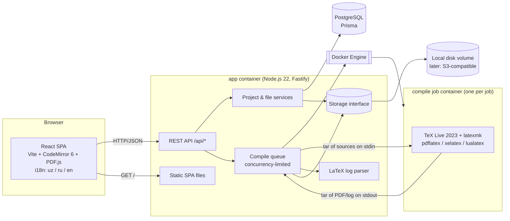
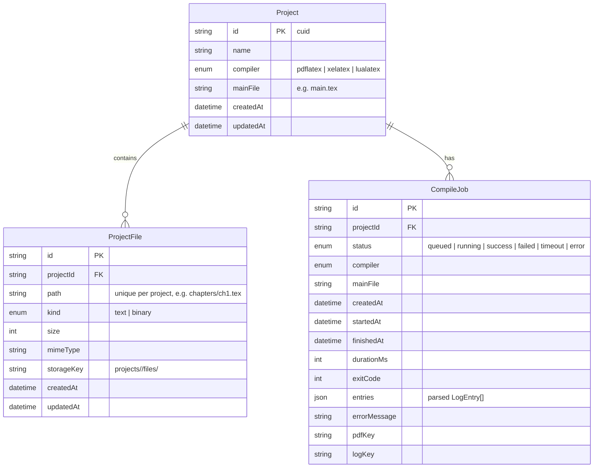
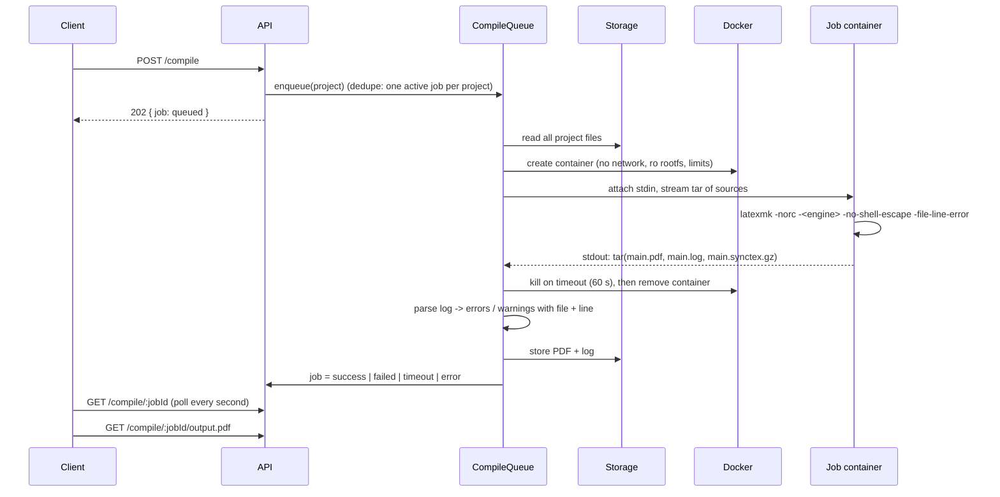

# Oversells — Architecture and Roadmap

Oversells is an online LaTeX editor (in the spirit of Overleaf) built for
educators and educational publishers, with first-class support for Uzbek
(Latin and Cyrillic) textbooks and mathematical content.

This document describes the target architecture for all phases, the details of
Phase 1 (MVP), and the decisions taken along the way.

---

## 1. Architecture overview



### Components

| Component | Technology | Responsibility |
|---|---|---|
| Web client | React 19, Vite, CodeMirror 6 (`stex` mode), pdfjs-dist, i18next | Project list, editor, file tree, PDF preview, error panel, auto-save |
| API server | Node.js 22, Fastify 5, Zod | REST API, validation, serving the built SPA |
| Database | PostgreSQL 16 via Prisma 6 | Projects, file metadata, compile jobs |
| Storage | `Storage` interface; `LocalDiskStorage` implementation | File contents and compile outputs (PDF, log) |
| Compiler | Docker image `oversells-texlive` (Ubuntu 24.04, TeX Live 2023) | Runs latexmk inside a locked-down, throw-away container per job |
| Shared package | `@oversells/shared` (TypeScript) | DTO types, path validation and file-name sanitising shared by client and server |

---

## 2. Data model (Phase 1)



* File **contents** never live in the database; the database stores metadata
  and a `storageKey`. Renaming or moving a file is a metadata-only update.
* Folders are implicit (derived from file paths). Empty folders exist only in
  the client until a file is created inside them.
* Phase 2 adds `User`, `Session`, `ProjectMember` / `ShareLink`, `Template`;
  Phase 3 adds `DocumentUpdate` (Yjs updates), `Comment`, `Snapshot`.

---

## 3. API (Phase 1)

All endpoints are under `/api`. Errors use one shape:
`{ "error": { "code": "file_exists", "message": "..." } }` — the client
translates `code` into the UI language.

| Method | Path | Description |
|---|---|---|
| GET | `/api/health` | Liveness + whether the compiler image is available |
| GET | `/api/projects` | List projects (most recently updated first) |
| POST | `/api/projects` | Create project `{ name, template?: "uzbek-textbook" \| "blank", compiler? }` |
| GET | `/api/projects/:id` | Project with its file list |
| PATCH | `/api/projects/:id` | Rename / change compiler / change main file |
| DELETE | `/api/projects/:id` | Delete project, its files and outputs |
| GET | `/api/projects/:id/download.zip` | Download the project sources as ZIP |
| POST | `/api/projects/:id/files` | Create a text file `{ path, content? }` |
| POST | `/api/projects/:id/upload?folder=&overwrite=` | Multipart upload (one or more files) |
| GET | `/api/projects/:id/files/:fileId` | Raw file content |
| PUT | `/api/projects/:id/files/:fileId/content` | Save text content `{ content }` (auto-save) |
| PATCH | `/api/projects/:id/files/:fileId` | Rename / move `{ path }` |
| DELETE | `/api/projects/:id/files/:fileId` | Delete file |
| POST | `/api/projects/:id/folders/rename` | Rename / move a folder `{ from, to }` |
| DELETE | `/api/projects/:id/folders?path=` | Delete a folder and everything in it |
| POST | `/api/projects/:id/compile` | Start a compile (`{ wait?: boolean }`); returns the job (202, or 200 when `wait`) |
| GET | `/api/projects/:id/compile/latest` | Latest compile job (`{ job: null }` if never compiled) |
| GET | `/api/projects/:id/compile/:jobId` | Job status, parsed errors/warnings |
| GET | `/api/projects/:id/compile/:jobId/output.pdf` | PDF (`?download=1` for attachment) |
| GET | `/api/projects/:id/compile/:jobId/output.log` | Raw LaTeX log + latexmk output |

---

## 4. Compile pipeline



### Sandbox per job

Every job runs in a **new** container from `oversells-texlive`:

* `NetworkMode: none` — no network at all.
* `ReadonlyRootfs: true`; writable space only on size-limited tmpfs mounts:
  `/work` (project + outputs, default 512 MB) and `/tmp` (TeX caches).
* `Memory` = `MemorySwap` (default 1 GB), `NanoCpus` (default 1 CPU),
  `PidsLimit` 256.
* `CapDrop: ALL`, `no-new-privileges`, runs as the unprivileged user `tex`
  (uid 1001).
* Wall-clock timeout (default 60 s): the server kills the container.
* `latexmk -norc` (no `latexmkrc` Perl execution), `-no-shell-escape`,
  `openout_any=p` (TeX may not write outside the work dir).
* No bind mounts: sources go in as a tar stream on **stdin**; outputs come back
  as a tar stream on **stdout** (size-capped). This also means the app works
  identically against a local or a remote Docker daemon.
* The container is always removed (`force: true`) after the job.

The server talks to the Docker Engine through `/var/run/docker.sock`. Access to
the socket is equivalent to root on the host — acceptable for a single-machine
deployment; Phase 4 moves compilation into a separate worker service (see
roadmap) so the public-facing app no longer needs the socket.

### Queue

* In-process queue with a global concurrency limit (`COMPILE_CONCURRENCY`,
  default 2).
* At most one active (queued/running) job per project; a second compile
  request returns the active job.
* On start-up, jobs left `queued`/`running` by a previous process are marked
  `error`.
* Only the outputs of the last 5 jobs per project are kept in storage.

### Log parsing

`-file-line-error` produces `./chapters/ch1.tex:12: Undefined control sequence.`
TeX's 79-column line wrapping is disabled in the image (`max_print_line`), so
those lines are parsed reliably. The parser also:

* handles classic `! ...` errors and picks the line from `l.<n>`,
* tracks the `(./file.tex ... )` file stack for warnings,
* extracts `LaTeX/Package ... Warning ... on input line N`,
* reports `Overfull/Underfull \hbox` as "typesetting" entries,
* ignores errors in system files' paths (reports them without a project file).

---

## 5. Folder structure

```
.
├── PLAN.md                 # this document
├── README.md
├── docker-compose.yml      # db + compiler image + app
├── Dockerfile              # app image (builds web + server)
├── .env.example
├── compiler/               # TeX Live sandbox image
│   ├── Dockerfile
│   └── run-latexmk.sh
├── packages/shared/        # @oversells/shared: DTOs, path rules
│   └── src/
├── apps/server/            # @oversells/server: Fastify API
│   ├── prisma/             # schema + migrations
│   ├── templates/          # project templates (uzbek-textbook, blank)
│   ├── src/
│   │   ├── config.ts
│   │   ├── app.ts          # buildApp(): wires services + routes
│   │   ├── index.ts        # process entry point
│   │   ├── errors.ts
│   │   ├── storage/        # Storage interface + LocalDiskStorage
│   │   ├── projects/       # project service + routes + templates + zip
│   │   ├── files/          # file service + routes
│   │   └── compile/        # runner interface, DockerRunner, queue, log parser
│   └── test/               # unit tests (vitest) and e2e tests
└── apps/web/               # @oversells/web: React SPA
    ├── src/
    │   ├── api/            # typed API client
    │   ├── i18n/           # uz / ru / en
    │   ├── pages/          # ProjectList, Editor
    │   └── components/     # FileTree, CodeEditor, PdfViewer, LogPanel, ...
    └── e2e/                # Playwright browser test
```

---

## 6. Roadmap and acceptance criteria

### Phase 1 — MVP (this session)

Scope: single user, no authentication (run locally / on a trusted network).

Acceptance criteria:

1. `docker compose up` starts PostgreSQL, builds the compiler image and the app;
   the UI is reachable on `http://localhost:3000`.
2. The project list supports create, rename and delete; new projects start from
   the Uzbek textbook template.
3. A project contains several files and folders (`.tex`, `.bib`, images, …);
   files can be created, uploaded, renamed/moved and deleted.
4. The editor highlights LaTeX syntax and auto-saves (debounced, with a visible
   saved/saving indicator).
5. "Compile" (or Ctrl/Cmd+Enter) produces a PDF shown side by side with the
   editor; pdfLaTeX / XeLaTeX / LuaLaTeX selectable per project.
6. Compile errors are listed with file and line; clicking one opens that file
   and jumps to the line.
7. The default template compiles without errors with XeLaTeX **and** LuaLaTeX
   and renders Uzbek Latin (oʻ, gʻ, ʼ) and Cyrillic (ў, қ, ғ, ҳ) correctly,
   with amsmath/amssymb/tikz/pgfplots/geometry.
8. The project can be downloaded as ZIP, the PDF can be downloaded.
9. Path traversal, disallowed file types, oversized uploads and dangerous file
   names are rejected; compilation never runs on the host.
10. UI is in Uzbek (Latin) by default and switchable to Russian and English.
11. Unit tests (paths, storage, project/file CRUD, compile queue, log parser)
    and an end-to-end test (create project → compile template → PDF) pass.

### Phase 2 — Accounts, sharing, templates

* Email + password accounts (argon2id hashes), HTTP-only session cookies,
  CSRF protection, password reset by email (SMTP config), rate limiting on auth.
* Every project gets an owner; all project routes check access.
* Share links: random tokens with role `viewer` or `editor`, revocable.
* Templates gallery: textbook, worksheet, exam paper, article (each with a
  preview PNG generated by compiling it); "create from template".
* Acceptance: a second user can open a shared link read-only / edit; without a
  link they get 404; template projects compile with zero errors.

### Phase 3 — Real-time collaboration

* Yjs documents per text file, synced over WebSocket (y-websocket protocol in
  the Fastify server), persisted as incremental updates + periodic snapshots in
  PostgreSQL; CodeMirror bound via `y-codemirror.next` with remote cursors.
* Comments anchored to Yjs relative positions; resolve/reopen.
* Version history: named and automatic snapshots, diff view, restore.
* Acceptance: two browsers editing the same file converge; history restore
  works; comments survive edits around them.

### Phase 4 — Power features and production

* SyncTeX both directions (the `.synctex.gz` is already produced in Phase 1).
* Spell checking (Hunspell dictionaries incl. Uzbek Latin/Cyrillic, Russian,
  English) in a web worker.
* AI assistance (explain an error, suggest a fix, generate exercises/TikZ),
  behind a feature flag and per-user quota.
* Admin panel (users, quotas, compile statistics).
* Deployment: separate stateless compile workers pulling jobs from a Redis/
  Postgres queue (the app no longer holds the Docker socket), gVisor/rootless
  runtime for jobs, S3-compatible storage (`S3Storage` implementing
  `Storage`), CDN for PDFs, horizontal scaling, backups, observability.
* Acceptance: click in PDF jumps to source and back; load test of N concurrent
  compiles meets the target latency.

---

## 7. Decisions

| # | Decision | Reason |
|---|---|---|
| D1 | Monorepo with npm workspaces (`apps/server`, `apps/web`, `packages/shared`). | One `npm install`, shared types and path rules without publishing packages. |
| D2 | Fastify 5 instead of Express. | Built-in schema/validation hooks, faster, first-class TypeScript and async error handling. |
| D3 | Prisma 6 (not 7). | Prisma 7 requires driver adapters and a new config layout; 6.x is stable and well documented. Upgrade later. |
| D4 | Compiler image based on Ubuntu 24.04 packages (TeX Live 2023) instead of the official `texlive/texlive` image. | ~1.7 GB instead of ~5 GB, reproducible apt install, all required packages present. Can switch to upstream TeX Live later by changing only `compiler/Dockerfile`. |
| D5 | Default font for the template: **Noto Serif / Noto Sans / DejaVu Sans Mono**. | CMU Serif (Computer Modern look) lacks U+02BB (ʻ) in italic, which breaks oʻ/gʻ inside theorems. Noto covers Uzbek Latin and Cyrillic in all styles. CMU and DejaVu are installed too. |
| D6 | Uzbek language via `babel` + `\babelprovide[import=uz-Latn, main]{uzbek}` and `\babelprovide[import=uz-Cyrl]{uzbekcyr}`. | The `uzbek-latin` package options do not exist in TL 2023's babel; the ini-based locales do. There are no Uzbek hyphenation patterns, so the template sets `\emergencystretch`. |
| D7 | New projects default to **XeLaTeX**. pdfLaTeX remains selectable. | fontspec/Unicode fonts are required for ʻ/ʼ and Cyrillic in one document. |
| D8 | No bind mounts for compile jobs; tar over stdin/stdout, tmpfs `/work`. | Works with Docker-in-Docker setups (no host path mapping), size-limited workspace, nothing written to host disk by TeX. |
| D9 | File names restricted to ASCII `[A-Za-z0-9._-]` per segment, no dot-files; uploads are sanitised (Cyrillic transliterated, spaces → `_`). | TeX handles non-ASCII/space file names poorly across engines; dot-file ban also blocks `.latexmkrc`. |
| D10 | Allowed file types: text (`tex, ltx, bib, bst, bbx, cbx, lbx, cls, sty, clo, cfg, def, dtx, ins, ist, tikz, txt, md, csv, tsv, dat`) and binary (`png, jpg, jpeg, pdf, eps, ttf, otf`). SVG is excluded. | SVG needs shell-escape (Inkscape) to be useful and is an XSS vector when served. Fonts are allowed so textbooks can use custom Uzbek fonts. |
| D11 | Limits (configurable): 20 MB per upload, 2 MB per text file, 500 files and 200 MB per project. | Sensible single-user defaults. |
| D12 | Text files must be valid UTF-8 (BOM stripped). | UTF-8 everywhere; invalid files are rejected with a clear message instead of silently corrupting text. |
| D13 | Compile API is asynchronous (202 + polling); `{ wait: true }` is available for scripts/tests. | Keeps HTTP requests short and maps naturally onto a worker queue in Phase 4. |
| D14 | Phase 1 has no authentication. | Explicitly out of scope; the README warns not to expose Phase 1 to the internet. |
| D15 | Upload of an existing path fails with 409 unless `overwrite=true`; the UI asks the user. | Avoids silent data loss. |
| D16 | Raw files are served with `X-Content-Type-Options: nosniff` and `Content-Security-Policy: sandbox`. | User-uploaded content must not execute in the app origin. |
| D17 | ZIP import is not part of Phase 1 (ZIP export is). | Not in the requested scope; planned with the templates work in Phase 2. |
| D18 | Empty folders are client-side only until a file is created in them. | Keeps the data model simple (paths only). |
| D19 | PDF.js pinned to 4.10.x. | PDF.js 5/6 rely on very new JavaScript APIs (e.g. `Map.prototype.getOrInsertComputed`) that many browsers in use (including Chromium 141) do not have yet. |
| D20 | Tests never reset databases destructively; they apply migrations with `prisma migrate deploy` to a dedicated `oversells_test` database (the name must contain `test`) and truncate tables themselves. | Protects real data. |
