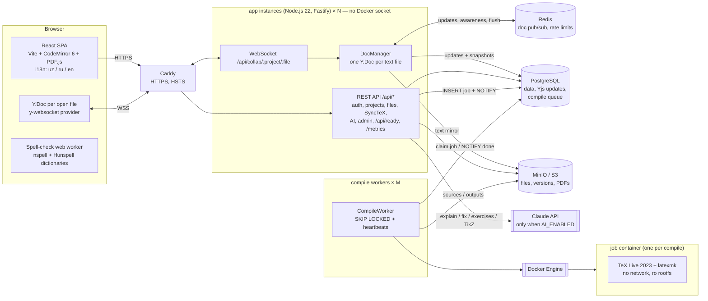
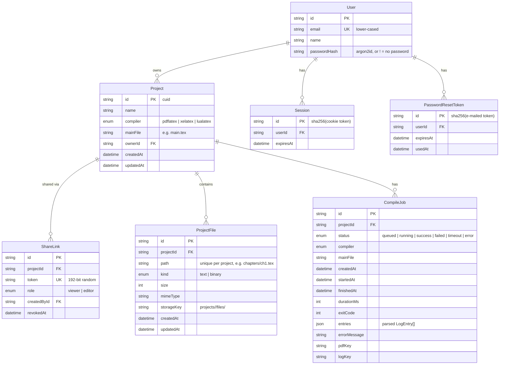

# Oversells — Architecture and Roadmap

Oversells is an online LaTeX editor (in the spirit of Overleaf) built for
educators and educational publishers, with first-class support for Uzbek
(Latin and Cyrillic) textbooks and mathematical content.

This document describes the target architecture for all phases, the details of
Phase 1 (MVP), and the decisions taken along the way.

---

## 1. Architecture overview

Production layout (Phase 4, `docker-compose.prod.yml`). For local work the
same services run without Caddy (`docker-compose.yml`), and the app can also
compile in-process (`COMPILE_MODE=inline`, Phases 1–3 style).



### Components

| Component | Technology | Responsibility |
|---|---|---|
| Web client | React 19, Vite, CodeMirror 6 (`stex` mode), pdfjs-dist, i18next, nspell (web worker) | Project list, editor, file tree, PDF preview with SyncTeX, error panel with AI help, spell checking, admin page |
| API server (app) | Node.js 22, Fastify 5, Zod, Yjs, pino | REST API, WebSocket collaboration, validation, serving the built SPA; stateless apart from loaded documents, so it scales horizontally |
| Compile worker | Same image, `worker` command | Takes queued jobs from PostgreSQL, runs the sandbox, stores outputs, renders template previews; the only container with the Docker socket |
| Database | PostgreSQL 16 via Prisma 6 | All metadata, Yjs update log, compile queue (`FOR UPDATE SKIP LOCKED`, LISTEN/NOTIFY) |
| Storage | `Storage` interface; `LocalDiskStorage` and `S3Storage` (MinIO, AWS S3) | File contents, version snapshots, compile outputs (PDF, log, SyncTeX), template previews |
| Redis | `ioredis` | Live documents across app instances (pub/sub), shared rate-limit counters |
| Reverse proxy | Caddy 2 | HTTPS (Let's Encrypt), HSTS, load balancing over app instances, WebSockets |
| AI | Claude API (`@anthropic-ai/sdk`) | Optional; off unless `AI_ENABLED=true` |
| Compiler | Docker image `oversells-texlive` (Ubuntu 24.04, TeX Live 2023) | Runs latexmk inside a locked-down, throw-away container per job |
| Shared package | `@oversells/shared` (TypeScript) | DTO types, path validation and file-name sanitising shared by client and server |

---

## 2. Data model (Phases 1–2)



* File **contents** never live in the database; the database stores metadata
  and a `storageKey`. Renaming or moving a file is a metadata-only update.
* Folders are implicit (derived from file paths). Empty folders exist only in
  the client until a file is created inside them.
* Templates are not in the database: they are directories under
  `apps/server/templates/<name>/` with a `template.json` (localized title and
  description, compiler, main file). Their preview PNGs are cached in storage
  under `templates/<name>/<content-hash>.png`.
* Phase 3 adds (see `apps/server/prisma/schema.prisma`):
  * `DocUpdate` — Yjs updates of a text file in order; `snapshot=true` rows
    hold a compacted full state that replaced all earlier rows;
  * `Version` — project version (`auto` / `named` / `restore`), with the text
    of all text files as JSON in storage (`projects/<pid>/versions/<vid>.json`);
  * `Comment` — thread root (anchors = encoded Yjs relative positions, quote)
    or reply (`parentId`); `resolvedAt`;
  * `SharedProjectAccess` — "shared with me" (user × share link), deleted when
    the link is revoked.
* Phase 4 adds:
  * `CompileJob.synctexKey` (stored `main.synctex.gz`), and for the queue
    `workerId`, `heartbeatAt`, `attempts`; a partial unique index allows one
    `queued`/`running` job per project; `CompileWorker` lists running workers;
  * `Project.spellLanguage` (`off`, `uz-latn`, `uz-cyrl`, `ru`, `en`) and
    `UserWord` (personal dictionary);
  * `User.role` (`user`/`admin`), `blockedAt`, and per-user overrides
    `maxProjects`, `storageQuotaBytes`, `aiDailyLimit` (null = server default);
  * `AiRequest` — one row per AI request (kind, tokens), for the daily quota
    and statistics.

---

## 3. API (Phases 1–3)

All endpoints are under `/api`. Errors use one shape:
`{ "error": { "code": "file_exists", "message": "..." } }` — the client
translates `code` into the UI language.

| Method | Path | Description |
|---|---|---|
| GET | `/api/health` | Liveness + whether the compiler image is available |
| GET | `/api/auth/me` | Current user (`{ user: null }` if logged out); issues the CSRF cookie |
| POST | `/api/auth/register` | `{ email, password, name? }` → creates account and session (rate limited) |
| POST | `/api/auth/login` | `{ email, password }` → session cookie (rate limited) |
| POST | `/api/auth/logout` | Ends the session |
| POST | `/api/auth/password-reset/request` | `{ email, lang? }` → e-mails a reset link; always `{ ok: true }` (rate limited) |
| POST | `/api/auth/password-reset/confirm` | `{ token, password }` → new password, all sessions ended (rate limited) |
| GET | `/api/templates` | Template gallery (localized titles/descriptions) |
| GET | `/api/templates/:name/preview.png` | First page of the compiled template |
| GET | `/api/share/:token` | Resolve a share link → `{ projectId, projectName, linkRole, role }` |
| GET | `/api/projects` | The caller's own projects (most recently updated first) — login required |
| POST | `/api/projects` | Create project `{ name, template?, compiler? }` — login required |
| GET | `/api/projects/:id` | Project with its file list and the caller's `access` (`owner`/`editor`/`viewer`) |
| PATCH | `/api/projects/:id` | Rename (owner) / change compiler or main file (editor) |
| DELETE | `/api/projects/:id` | Delete project, its files and outputs (owner) |
| GET | `/api/projects/:id/download.zip` | Download the project sources as ZIP |
| GET | `/api/projects/:id/share-links` | Active share links (owner) |
| POST | `/api/projects/:id/share-links` | Create a link `{ role: "viewer" \| "editor" }` (owner) |
| DELETE | `/api/projects/:id/share-links/:linkId` | Revoke a link (owner) |
| POST | `/api/projects/:id/files` | Create a text file `{ path, content? }` |
| POST | `/api/projects/:id/upload?folder=&overwrite=` | Multipart upload (one or more files) |
| GET | `/api/projects/:id/files/:fileId` | Raw file content |
| PUT | `/api/projects/:id/files/:fileId/content` | Save text content `{ content }` (auto-save) |
| PATCH | `/api/projects/:id/files/:fileId` | Rename / move `{ path }` |
| DELETE | `/api/projects/:id/files/:fileId` | Delete file |
| POST | `/api/projects/:id/folders/rename` | Rename / move a folder `{ from, to }` |
| DELETE | `/api/projects/:id/folders?path=` | Delete a folder and everything in it |
| POST | `/api/projects/:id/compile` | Start a compile (`{ wait?: boolean }`); returns the job (202, or 200 when `wait`) |
| GET | `/api/projects/:id/compile/latest` | Latest compile job (`{ job: null }` if never compiled) |
| GET | `/api/projects/:id/compile/:jobId` | Job status, parsed errors/warnings |
| GET | `/api/projects/:id/compile/:jobId/output.pdf` | PDF (`?download=1` for attachment) |
| GET | `/api/projects/:id/compile/:jobId/output.log` | Raw LaTeX log + latexmk output |
| WS | `/api/collab/:id/:fileId[?share=]` | Real-time editing of one text file (y-websocket protocol); viewers read-only |
| GET | `/api/projects/shared` | Projects the user opened through share links ("shared with me") |
| GET | `/api/projects/:id/comments[?fileId=]` | Comment threads with replies and current range (read) |
| POST | `/api/projects/:id/comments` | Start a thread `{ fileId, anchorStart, anchorEnd, body }` (write) |
| POST | `/api/projects/:id/comments/:commentId/replies` | Reply `{ body }` (write) |
| PATCH | `/api/projects/:id/comments/:commentId` | Resolve / reopen `{ resolved }` (write) |
| DELETE | `/api/projects/:id/comments/:commentId` | Delete (author or owner) |
| GET | `/api/projects/:id/versions` | Version list (read) |
| POST | `/api/projects/:id/versions` | Save a named version `{ name }` (write) |
| GET | `/api/projects/:id/versions/current` | Current text of all text files (for diffs) |
| GET | `/api/projects/:id/versions/:versionId` | Text of all files in a version |
| POST | `/api/projects/:id/versions/:versionId/restore` | Restore as a new change (write) |

### Phase 4 endpoints

| Method | Path | Description |
|---|---|---|
| GET | `/projects/:id/compile/:jobId/synctex/code?file&line` | Source → PDF: `{ position: { page, x, y, boxes[] } }` (PDF points from the top-left) |
| GET | `/projects/:id/compile/:jobId/synctex/pdf?page&x&y` | PDF → source: `{ source: { file, line, fileId } }` |
| GET / POST / DELETE | `/me/dictionary`, `/me/dictionary/:word` | Personal spell-check dictionary |
| GET | `/ai/status` | `{ enabled, remaining, dailyLimit }` |
| POST | `/projects/:id/ai/explain` | `{ jobId, entry, lang }` → explanation of a log entry (read access) |
| POST | `/projects/:id/ai/fix` | Same input → `{ fileId, path, startLine, endLine, original, suggestion, explanation }` (write access) |
| POST | `/projects/:id/ai/exercises` | `{ topic, count, level, lang }` → `{ latex, preambleAdditions }` |
| POST | `/projects/:id/ai/tikz` | `{ description, lang }` → `{ latex, preambleAdditions }` |
| GET | `/admin/users?q&offset&limit` | Users with usage (projects, storage, AI today, compiles 7 d, last seen) — admins only |
| PATCH | `/admin/users/:userId` | `{ blocked?, role?, maxProjects?, storageQuotaBytes?, aiDailyLimit? }` |
| GET | `/admin/stats` | Users, projects, compiles (24 h / 7 d by status, avg/p95, queue, 14-day chart), storage, AI |
| GET | `/ready` | Readiness: database, Redis, S3 (503 if one fails); the compiler state is reported, not required |
| GET | `/metrics` (no `/api`) | Prometheus metrics; `Authorization: Bearer METRICS_TOKEN`, 404 without a token configured |

AI routes answer `404 ai_disabled` before reading the request when AI is off,
require a logged-in user (the quota is per user) and answer `429 ai_quota`
when the day's requests are used up. Admin routes answer 401/403 to everyone
but admins.

### Authentication and access rules (Phase 2)

* **Session**: random 256-bit token in the HTTP-only, `SameSite=Lax`
  cookie `oversells_session` (`Secure` with `COOKIE_SECURE=true`); the
  database stores only its SHA-256. 30-day lifetime; logout and password reset
  delete sessions server-side.
* **CSRF**: double-submit cookie. Every API response sets a readable
  `oversells_csrf` cookie if missing; every non-GET API request must echo it
  in `X-CSRF-Token`, otherwise `403 csrf_failed`. Cross-site pages can neither
  read the cookie nor send the header.
* **Passwords**: argon2id (19 MiB, t=2, p=1), 8–200 characters; login failures
  return the same error for unknown e-mail and wrong password, with equal work.
* **Rate limiting**: `AUTH_RATE_LIMIT_MAX` requests per IP per window on
  register, login and both password-reset endpoints → `429 rate_limited`.
* **Access** (checked on every project, file and compile route):

  | Caller | Read files, ZIP, compile, PDF | Edit files, compiler, main file | Rename, delete, share |
  |---|---|---|---|
  | Owner | ✓ | ✓ | ✓ |
  | Logged-in user with an editor link | ✓ | ✓ | 403 |
  | Anonymous user with an editor link | ✓ | 403 | 403 |
  | Anyone with a viewer link | ✓ | 403 | 403 |
  | Anyone else | 404 | 404 | 404 |

  The share token travels in `X-Share-Token` (API calls) or `?share=` (plain
  URLs such as the PDF, ZIP and images, which cannot carry headers).

### Real-time collaboration (Phase 3)

```mermaid
sequenceDiagram
  participant A as Browser A (owner)
  participant S as Server (DocManager)
  participant B as Browser B (editor link)
  participant P as PostgreSQL / storage
  A->>S: WebSocket /api/collab/:p/:f (cookie; Origin checked)
  S->>S: access check → owner (read/write)
  S->>P: load DocUpdate rows (or seed from stored text)
  S-->>A: sync step 1/2 (state), awareness
  B->>S: WebSocket (?share=token) → editor
  A->>S: update (keystrokes)
  S-->>B: update (broadcast)
  S->>P: append DocUpdate (debounced batch); every N batches → one snapshot row
  S->>P: write plain text to storage (debounced) — compile/ZIP read this
```

* **One Y.Doc per text file**, Y.Text named `content`. The server holds a
  document while anyone is connected (plus `COLLAB_UNLOAD_AFTER_MS`).
* **Viewers** connect too (they see live edits and cursors), but the server
  answers only their sync step 1 and drops their sync step 2 / updates.
* **REST writes** (PUT content, upload overwrite, restore) are applied to the
  Y.Doc as a character diff, so connected editors see them live and comment
  anchors survive.
* **Compile and ZIP** flush live documents to storage first.
* **Offline**: the browser keeps editing its Y.Doc; y-websocket reconnects
  with backoff and both sides exchange the missing updates (CRDT merge).
* **Revocation**: revoking a share link closes the WebSocket sessions opened
  with it (close code 4403).
* **Versions**: automatic while editing (at most every
  `AUTO_VERSION_INTERVAL_MS`, default 10 min) and when the last person leaves a
  changed document; identical states are not saved twice. Restoring saves the
  current state first, then applies the old text as a normal change and saves
  a `restore` version — nothing is ever overwritten.

### Several app instances (Phase 4)

With `REDIS_URL` set, every instance that has a document loaded subscribes
to `oversells:doc:<fileId>`:

* local updates and awareness changes are published; updates from other
  instances are applied and broadcast to local clients but **persisted only by
  the instance where they were made**;
* an instance that loads a document publishes `sync-req` with its state
  vector; instances holding it answer with the missing updates;
* compaction merges the rows in the database (not the instance's memory);
  seeding a document from storage happens under an advisory lock;
* before compile, ZIP, versions and server-side edits, `flushProject` asks all
  other live instances (registry in Redis) to persist their documents and
  waits for their answers (at most 3 s);
* closing connections (revoked link, blocked user) and dropping documents
  (deleted file/project) are broadcast on `oversells:control`.

So any instance can serve any WebSocket: no sticky sessions.

---

## 4. Compile pipeline

```mermaid
sequenceDiagram
  participant C as Client
  participant A as API
  participant Q as CompileQueue
  participant S as Storage
  participant D as Docker
  participant J as Job container

  C->>A: POST /compile
  A->>Q: enqueue(project) (dedupe: one active job per project)
  A-->>C: 202 { job: queued }
  Q->>S: read all project files
  Q->>D: create container (no network, ro rootfs, limits)
  Q->>J: attach stdin, stream tar of sources
  J->>J: latexmk -norc -<engine> -no-shell-escape -file-line-error
  J-->>Q: stdout: tar(main.pdf, main.log, main.synctex.gz)
  Q->>D: kill on timeout (240 s; desktop 30 min), then remove container
  Q->>Q: parse log -> errors / warnings with file + line
  Q->>S: store PDF + log
  Q->>A: job = success | failed | timeout | error
  C->>A: GET /compile/:jobId (poll every second)
  C->>A: GET /compile/:jobId/output.pdf
```

### Sandbox per job

Every job runs in a **new** container from `oversells-texlive`:

* `NetworkMode: none` — no network at all.
* `ReadonlyRootfs: true`; writable space only on size-limited tmpfs mounts:
  `/work` (project + outputs, default 512 MB) and `/tmp` (TeX caches).
* `Memory` = `MemorySwap` (default 1 GB), `NanoCpus` (default 1 CPU),
  `PidsLimit` 256.
* `CapDrop: ALL`, `no-new-privileges`, runs as the unprivileged user `tex`
  (uid 1001).
* Wall-clock timeout (default 240 s; the desktop and one-person setups allow
  30 and 20 minutes for big books): the server kills the container.
* The auxiliary files of the last successful compile (`.aux`, `.toc`, `.bbl`,
  `.fdb_latexmk`, ...) go back in as `.oversells-cache.tar`, so latexmk
  usually needs one pass instead of three (see D87).
* `latexmk -norc` (no `latexmkrc` Perl execution), `-no-shell-escape`,
  `openout_any=p` (TeX may not write outside the work dir).
* No bind mounts: sources go in as a tar stream on **stdin**; outputs come back
  as a tar stream on **stdout** (size-capped). This also means the app works
  identically against a local or a remote Docker daemon.
* The container is always removed (`force: true`) after the job.

Only the compile worker talks to the Docker Engine (`/var/run/docker.sock`,
root-equivalent); the public-facing app does not mount the socket.

### Queue

`COMPILE_MODE=queue` (docker-compose):

1. The app flushes live documents (on all instances), then inserts a
   `queued` job and sends `NOTIFY oversells_compile_queued`. A partial unique
   index allows one queued/running job per project, so a second request from
   any instance joins the active job.
2. Workers take the oldest job with
   `UPDATE … WHERE id = (SELECT … FOR UPDATE SKIP LOCKED LIMIT 1)`
   (`COMPILE_CONCURRENCY` per worker), woken by NOTIFY or every
   `COMPILE_POLL_MS`.
3. While running, the worker refreshes `heartbeatAt`; any worker re-queues
   jobs whose heartbeat is older than `WORKER_STALE_MS` (after
   `WORKER_MAX_ATTEMPTS` attempts the job fails instead).
4. The result is stored, then `NOTIFY oversells_compile_done`; apps waiting
   (`wait: true`) wake up, browsers keep polling the job.

`COMPILE_MODE=inline` (tests, simple setups) runs the same processor in the
app process with the same concurrency limit; on start-up it marks jobs left
`queued`/`running` by a previous process as `error`.

Only the outputs of the last 5 jobs per project are kept in storage.

### Log parsing

`-file-line-error` produces `./chapters/ch1.tex:12: Undefined control sequence.`
TeX's 79-column line wrapping is disabled in the image (`max_print_line`), so
those lines are parsed reliably. The parser also:

* handles classic `! ...` errors and picks the line from `l.<n>`,
* tracks the `(./file.tex ... )` file stack for warnings,
* extracts `LaTeX/Package ... Warning ... on input line N`,
* reports `Overfull/Underfull \hbox` as "typesetting" entries,
* ignores errors in system files' paths (reports them without a project file).

---

## 5. Folder structure

```
.
├── PLAN.md                 # this document
├── README.md
├── docker-compose.yml      # local: app, worker, db, redis, minio, compiler image
├── docker-compose.prod.yml # production: + Caddy (HTTPS), app replicas
├── deploy/Caddyfile
├── docs/BACKUPS.md
├── Dockerfile              # app image (builds web + server); "app" / "worker" commands
├── .env.example
├── compiler/               # TeX Live sandbox image
│   ├── Dockerfile
│   └── run-latexmk.sh
├── packages/shared/        # @oversells/shared: DTOs, path rules
│   └── src/
├── apps/server/            # @oversells/server: Fastify API
│   ├── prisma/             # schema + migrations
│   ├── templates/          # project templates: textbook, worksheet, exam, article, blank
│   ├── src/
│   │   ├── config.ts
│   │   ├── app.ts          # buildApp(): wires services + routes
│   │   ├── index.ts        # app entry point
│   │   ├── worker.ts       # compile worker entry point
│   │   ├── metrics.ts logging.ts maintenance.ts
│   │   ├── errors.ts
│   │   ├── storage/        # Storage interface, LocalDiskStorage, S3Storage
│   │   ├── projects/       # project service + routes + templates + zip
│   │   ├── files/          # file service + routes
│   │   ├── auth/ access/ share/  # accounts, access rules, share links
│   │   ├── collab/         # DocManager (Yjs), Redis bus, WebSocket route, text diff
│   │   ├── versions/       # version history, retention
│   │   ├── comments/       # comment threads
│   │   ├── synctex/        # SyncTeX parser (both directions) + service
│   │   ├── ai/             # Claude client, prompts (uz/ru/en), quota, routes
│   │   ├── admin/          # quotas, admin service + routes
│   │   ├── tools/          # copy-storage (local → S3)
│   │   └── compile/        # runner, DockerRunner, processor, service, worker, notifier, log parser
│   └── test/               # unit tests (vitest) and e2e tests
└── apps/web/               # @oversells/web: React SPA
    ├── src/
    │   ├── api/            # typed API client
    │   ├── collab/         # CollabSession: Y.Doc + provider per open file
    │   ├── spell/          # tokenizer, web worker, CodeMirror extension
    │   ├── ai/             # applying AI suggestions as minimal edits
    │   ├── i18n/           # uz / ru / en
    │   ├── pages/          # ProjectList, Editor, Templates, Admin, auth
    │   └── components/     # FileTree, CodeEditor, PdfViewer, LogPanel, ...
    ├── dictionaries/       # Uzbek Cyrillic word list (source of the uz dictionaries)
    ├── scripts/            # build-dictionaries.mjs
    └── e2e/                # Playwright browser tests (+ mock Messages API)
```

---

## 6. Roadmap and acceptance criteria

### Phase 1 — MVP ✅ done

Scope: single user, no authentication (run locally / on a trusted network).

Acceptance criteria:

1. `docker compose up` starts PostgreSQL, builds the compiler image and the app;
   the UI is reachable on `http://localhost:3000`.
2. The project list supports create, rename and delete; new projects start from
   the Uzbek textbook template.
3. A project contains several files and folders (`.tex`, `.bib`, images, …);
   files can be created, uploaded, renamed/moved and deleted.
4. The editor highlights LaTeX syntax and auto-saves (debounced, with a visible
   saved/saving indicator).
5. "Compile" (or Ctrl/Cmd+Enter) produces a PDF shown side by side with the
   editor; pdfLaTeX / XeLaTeX / LuaLaTeX selectable per project.
6. Compile errors are listed with file and line; clicking one opens that file
   and jumps to the line.
7. The default template compiles without errors with XeLaTeX **and** LuaLaTeX
   and renders Uzbek Latin (oʻ, gʻ, ʼ) and Cyrillic (ў, қ, ғ, ҳ) correctly,
   with amsmath/amssymb/tikz/pgfplots/geometry.
8. The project can be downloaded as ZIP, the PDF can be downloaded.
9. Path traversal, disallowed file types, oversized uploads and dangerous file
   names are rejected; compilation never runs on the host.
10. UI is in Uzbek (Latin) by default and switchable to Russian and English.
11. Unit tests (paths, storage, project/file CRUD, compile queue, log parser)
    and an end-to-end test (create project → compile template → PDF) pass.

### Phase 2 — Accounts, sharing, templates ✅ done

* Email + password accounts (argon2id hashes), HTTP-only session cookies,
  CSRF protection, password reset by email (SMTP config), rate limiting on auth.
* Every project gets an owner; all project routes check access.
* Share links: random tokens with role `viewer` or `editor`, revocable.
* Templates gallery: textbook, worksheet, exam paper, article (each with a
  preview PNG generated by compiling it); "create from template".
* Acceptance: a second user can open a shared link read-only / edit; without a
  link they get 404; template projects compile with zero errors.
* Delivered as: unit tests for auth, CSRF, rate limiting, password reset, the
  full access matrix and share links; API e2e compiling all five templates in
  the sandbox (no errors, no warnings in the final log); Playwright tests for
  register → template → compile and for sharing with a second browser context.

### Phase 3 — Real-time collaboration ✅ done

* Yjs documents per text file, synced over WebSocket (y-websocket protocol in
  the Fastify server), persisted as incremental updates + periodic snapshots in
  PostgreSQL; CodeMirror bound via `y-codemirror.next` with remote cursors.
* Comments anchored to Yjs relative positions; resolve/reopen.
* Version history: named and automatic snapshots, diff view, restore.
* "Shared with me": projects opened through a link, until it is revoked.
* Acceptance: two browsers editing the same file converge; history restore
  works; comments survive edits around them.
* Delivered as: unit tests for WebSocket access (owner/editor/viewer/anonymous/
  stranger/foreign Origin/binary file), live REST saves, offline edits and
  reconnect, awareness, persistence and compaction, versions (auto/named/
  restore), comment anchoring through edits and restores, shared-with-me;
  Playwright test with two browser contexts (concurrent typing, comment,
  history restore).

### Phase 4 — Power features and production ✅ done

* SyncTeX both directions: double-click in the PDF opens the source line;
  "PDF" in the editor highlights and scrolls to the line in the PDF.
* Spell checking in a web worker (nspell + Hunspell dictionaries for Uzbek
  Latin, Uzbek Cyrillic, Russian, English), per-project language, LaTeX
  commands and math ignored, suggestions in a context menu, personal
  dictionary.
* AI assistance behind `AI_ENABLED` and a per-user daily quota: explain a
  compile error, suggest a fix (diff, accepted by the user), generate
  exercises, TikZ from a description; prompts in uz/ru/en.
* Admin panel (`/admin`, role `admin`): users, block/unblock, quotas,
  compile and storage statistics.
* Production: compile worker service with a PostgreSQL queue (the app has no
  Docker socket), `S3Storage` (MinIO in compose), Redis pub/sub for several
  app instances, version retention, structured logs, `/api/ready`,
  `/metrics`, backups documentation (`docs/BACKUPS.md`), production compose
  with Caddy (HTTPS).
* Delivered as: unit tests for the SyncTeX parser (matches the `synctex` CLI),
  tokenizer and dictionaries, AI service with a fake client and the SDK client
  against a local mock API, admin access control/blocking/quotas/statistics,
  the queue and worker (claiming, sharing between workers, heartbeats, lost
  workers), two app instances through Redis (convergence, presence, flush
  before compile, revocation, shared rate limits), S3 storage, retention,
  readiness and metrics; API e2e compiling through a worker with Docker;
  Playwright tests for SyncTeX click-through, spell suggestions, AI with a
  mocked Messages API, the admin panel, and two browsers on two app instances.
* Later (not in this phase): gVisor/rootless runtime for job containers, a CDN
  for PDFs, a load test with a latency target.

### Phase 5 — Designs ✅ done

* Design system: a `DesignSpec` (fonts, colours, heading/box/page/drawing
  styles) is turned into `dizayn.sty`; six built-in designs; users' own
  designs (`Design` table); previews compile a showcase document (render jobs,
  inline or on a worker) and are cached by content hash.
* Editor: "Dizayn" gallery with live samples, apply with the titles' language,
  design editor with live preview, design from pages of a book (AI),
  "Chizma va formulalar" menu with 22 ready pieces.
* Templates textbook, worksheet and article use designs.
* AI exercise/TikZ generation uses the design's helpers when the document
  loads the package.
* Delivered as: generator, API, worker and AI unit tests; sandbox e2e of every
  design and snippet (XeLaTeX + LuaLaTeX, no warnings); Playwright test of
  the whole flow.

### Big books (1000+ pages) ✅ done

* PDF viewer: pages are sized placeholders; only those within ~1500 px of the
  viewport hold a canvas, the rest are released. Page number box to jump to
  any page; after a recompile or zoom the reader stays on the same spot.
* Compiles reuse the auxiliary files of the last successful compile (one
  LaTeX pass instead of three for a book); longer timeouts and more memory in
  the desktop and one-person setups; larger file, project and upload limits.
* SyncTeX data in typed arrays with page and file indexes (a 1000-page book:
  ~600 000 records, a few MB instead of hundreds); the cache is bounded by
  memory. Fixed a stack overflow (`Math.min(...hugeArray)`) in forward search.
* Delivered as: unit tests (cache handling), a Docker e2e test (second
  compile of a book needs one pass), a Playwright test with a 1000-page book
  (canvas count stays small, jump to page 750, SyncTeX there, recompile keeps
  the page). Measured: a 1003-page book in the zamonaviy design, 1 CPU,
  1 GB: 95 s first compile, 33 s after an edit.

---

## 7. Decisions

| # | Decision | Reason |
|---|---|---|
| D1 | Monorepo with npm workspaces (`apps/server`, `apps/web`, `packages/shared`). | One `npm install`, shared types and path rules without publishing packages. |
| D2 | Fastify 5 instead of Express. | Built-in schema/validation hooks, faster, first-class TypeScript and async error handling. |
| D3 | Prisma 6 (not 7). | Prisma 7 requires driver adapters and a new config layout; 6.x is stable and well documented. Upgrade later. |
| D4 | Compiler image based on Ubuntu 24.04 packages (TeX Live 2023) instead of the official `texlive/texlive` image. | ~1.7 GB instead of ~5 GB, reproducible apt install, all required packages present. Can switch to upstream TeX Live later by changing only `compiler/Dockerfile`. |
| D5 | Default font for the template: **Noto Serif / Noto Sans / DejaVu Sans Mono**. | CMU Serif (Computer Modern look) lacks U+02BB (ʻ) in italic, which breaks oʻ/gʻ inside theorems. Noto covers Uzbek Latin and Cyrillic in all styles. CMU and DejaVu are installed too. |
| D6 | Uzbek language via `babel` + `\babelprovide[import=uz-Latn, main]{uzbek}` and `\babelprovide[import=uz-Cyrl]{uzbekcyr}`. | The `uzbek-latin` package options do not exist in TL 2023's babel; the ini-based locales do. There are no Uzbek hyphenation patterns, so the template sets `\emergencystretch`. |
| D7 | New projects default to **XeLaTeX**. pdfLaTeX remains selectable. | fontspec/Unicode fonts are required for ʻ/ʼ and Cyrillic in one document. |
| D8 | No bind mounts for compile jobs; tar over stdin/stdout, tmpfs `/work`. | Works with Docker-in-Docker setups (no host path mapping), size-limited workspace, nothing written to host disk by TeX. |
| D9 | File names restricted to ASCII `[A-Za-z0-9._-]` per segment, no dot-files; uploads are sanitised (Cyrillic transliterated, spaces → `_`). | TeX handles non-ASCII/space file names poorly across engines; dot-file ban also blocks `.latexmkrc`. |
| D10 | Allowed file types: text (`tex, ltx, bib, bst, bbx, cbx, lbx, cls, sty, clo, cfg, def, dtx, ins, ist, tikz, txt, md, csv, tsv, dat`) and binary (`png, jpg, jpeg, pdf, eps, ttf, otf`). SVG is excluded. | SVG needs shell-escape (Inkscape) to be useful and is an XSS vector when served. Fonts are allowed so textbooks can use custom Uzbek fonts. |
| D11 | Limits (configurable): 20 MB per upload, 2 MB per text file, 500 files and 200 MB per project. | Sensible single-user defaults. |
| D12 | Text files must be valid UTF-8 (BOM stripped). | UTF-8 everywhere; invalid files are rejected with a clear message instead of silently corrupting text. |
| D13 | Compile API is asynchronous (202 + polling); `{ wait: true }` is available for scripts/tests. | Keeps HTTP requests short and maps naturally onto a worker queue in Phase 4. |
| D14 | Phase 1 has no authentication. | Explicitly out of scope; the README warns not to expose Phase 1 to the internet. |
| D15 | Upload of an existing path fails with 409 unless `overwrite=true`; the UI asks the user. | Avoids silent data loss. |
| D16 | Raw files are served with `X-Content-Type-Options: nosniff` and `Content-Security-Policy: sandbox`. | User-uploaded content must not execute in the app origin. |
| D17 | ZIP import is not part of Phase 1 (ZIP export is). | Not in the requested scope; planned with the templates work in Phase 2. |
| D18 | Empty folders are client-side only until a file is created in them. | Keeps the data model simple (paths only). |
| D19 | PDF.js pinned to 4.10.x. | PDF.js 5/6 rely on very new JavaScript APIs (e.g. `Map.prototype.getOrInsertComputed`) that many browsers in use (including Chromium 141) do not have yet. |
| D20 | Tests never reset databases destructively; they apply migrations with `prisma migrate deploy` to a dedicated `oversells_test` database (the name must contain `test`) and truncate tables themselves. | Protects real data. |
| D21 | Sessions in PostgreSQL (hashed token) instead of JWTs. | Server-side revocation (logout, password reset) is trivial; one DB lookup per API request is cheap at this scale. |
| D22 | CSRF via double-submit cookie + `X-CSRF-Token` header, together with `SameSite=Lax` session cookies. | Works for JSON and multipart requests without server-side token storage; also covers login CSRF. |
| D23 | argon2id through `@node-rs/argon2` (prebuilt, no compiler needed) with OWASP baseline parameters. | Fast installs on every platform and in Docker. |
| D24 | Share tokens are stored as-is (not hashed) and shown to the owner again in the share dialog. | The owner needs to copy existing links; a token only grants access to one project and can be revoked. Session and password-reset tokens *are* hashed. |
| D25 | Editor links grant editing only to logged-in users; anonymous holders get viewer rights and a "log in to edit" prompt. | Edits stay attributable (needed for Phase 3 history and comments). |
| D26 | Access via a link is not remembered as membership; the link must be used each time ("Shared with me" is Phase 3 material). | Keeps revocation exact: revoking a link immediately removes all access it granted. |
| D27 | Unknown or inaccessible projects answer 404 (not 403); 403 only when the caller can see the project but lacks the role. | Project ids cannot be probed. |
| D28 | Existing (Phase 1) projects are moved to a placeholder user `default-owner` without a password by the migration; `DEFAULT_OWNER_EMAIL`/`DEFAULT_OWNER_PASSWORD` claim it at start-up (or move the projects to an existing account with that e-mail). | No data loss and no hard-coded password. |
| D29 | Without `SMTP_HOST`, e-mails go to the server log. Reset e-mails are sent in the UI language (uz/ru/en). | Works out of the box in development, as required. |
| D30 | Templates live on disk with a `template.json`; previews are produced by compiling the template in the sandbox and rendering page 1 with `pdftoppm` (added to the compiler image), cached by content hash and warmed at start-up. | A preview is always exactly what the template compiles to; editing a template refreshes its preview automatically. |
| D31 | The Phase 1 template `uzbek-textbook` was renamed to `textbook`. | Consistent gallery names (textbook, worksheet, exam, article, blank). |
| D32 | The exam template uses the `exam` class with Uzbek labels; the article uses BibTeX (`unsrt`) rather than biblatex. | biblatex has no Uzbek localization and warns; BibTeX keeps the template at zero warnings. |
| D33 | Yjs + y-websocket protocol implemented directly in the Fastify server (`@fastify/websocket`, `y-protocols`), not the stock `y-websocket` server. | The access check (cookies, share token, Origin) must run before the upgrade, and viewers need a read-only filter on sync messages. |
| D34 | One Y.Doc per text file (not one per project). | Matches the editor (one file open at a time), keeps documents small and loads only what is edited. |
| D35 | Persistence: append every debounced batch of updates to `DocUpdate`, replace the log by a single snapshot every `COLLAB_COMPACT_AFTER` batches. The plain text is mirrored to storage (debounced, and flushed before compile/ZIP/versions). | Cheap writes while typing, bounded load time, and every non-collaborative feature keeps reading plain files. |
| D36 | Server-side text changes (REST save, upload overwrite, restore) are applied as a character diff (`diff` package; prefix/suffix replace above 200k characters). | Unchanged text keeps its Yjs identity, so comments and remote cursors stay where they are. |
| D37 | Viewers join the WebSocket (live view and cursors) but the server ignores their document updates; anonymous holders of an editor link are viewers (as in Phase 2). | Same rules as the REST API, enforced server-side. |
| D38 | WebSocket handshakes with an `Origin` other than the app's host (or `APP_URL`) are refused (403). | Cookie-authenticated WebSockets are not covered by CORS or the CSRF header (cross-site WebSocket hijacking). |
| D39 | Awareness (cursor name and colour) is set by the client and not verified. | It is display-only; edits and comments are attributed server-side. Verified identities in awareness can come later. |
| D40 | Comments are stored in PostgreSQL with Yjs relative positions; clients refresh them every 5 s instead of over the WebSocket. | Simple and robust; comment traffic is low. A push channel can be added without changing the data model. |
| D41 | A thread whose text was deleted is kept and shown as "detached" (the range collapsed although the quote was not empty). | No silent loss of discussion. |
| D42 | Versions store full text of all text files (JSON in storage); binary files are not versioned. (Retention: D70.) | Simple restore and diff; storage is cheap at this scale. |
| D43 | Restore never deletes files that were added after the version; files deleted since are re-created; renamed files are moved back when the old path is free. | Restoring must not destroy work. |
| D44 | "Shared with me" is recorded when a logged-in non-owner opens a link and removed when the link is revoked. | Exact revocation semantics from D26 are kept. |
| D45 | ~~Single server process holds the live documents.~~ Superseded by D66 (Redis bus). | Enough for Phase 3. |
| D46 | The auth rate limit applies to the e2e test server too; test runs set `AUTH_RATE_LIMIT_MAX` high. | Many registrations from one IP in a minute are exactly what the limit is for. |
| D47 | SyncTeX is parsed on the server by our own TypeScript parser (no `synctex` binary in the app image); the `.synctex.gz` is stored next to the PDF (pruned with it), parsed once and cached (LRU, 20 jobs). | The app container has no TeX installation; the parser matches the `synctex` CLI on every text line of the textbook template (tested against CLI output). |
| D48 | Forward search returns the outermost line boxes of the line (merged per page) and the PDF highlights them; reverse search picks the smallest box containing the point, else the nearest line, then descends to the leaf just left of the point. | Highlights whole lines like Overleaf; clicks between lines or in margins still land on a sensible line. |
| D49 | PDF → source is a double-click in the PDF; source → PDF is the "PDF" button (cursor line) in the editor title bar. | Single clicks are used for text selection and scrolling in the PDF. |
| D50 | Spell checking runs entirely in the browser (nspell in a web worker); dictionaries are static files under `/dict/`. | No text leaves the browser, no server load, works for viewers too. |
| D51 | Dictionaries: English and Russian from the `dictionary-en` / `dictionary-ru` packages; Uzbek Cyrillic from Debian's `hunspell-uz` word list (GPL-2+, committed in `apps/web/dictionaries/`); **Uzbek Latin is generated** from it by the official Cyrillic → Latin transliteration (oʻ/gʻ with U+02BB, ʼ U+02BC). | There is no maintained Uzbek Latin Hunspell dictionary; transliterating the Cyrillic one gives the same coverage in both scripts. |
| D52 | Per-project language (`off`, `uz-latn`, `uz-cyrl`, `ru`, `en`; default `uz-latn`); each word is checked against the dictionary of its script (Latin words in an Uzbek-Cyrillic project use Uzbek Latin, Cyrillic words in an English project use Russian). | Textbooks mix scripts and languages; checking a Russian word against the English dictionary would mark everything. |
| D53 | The tokenizer skips comments, command names, arguments of non-prose commands (`\label`, `\ref`, `\usepackage`, ...), inline/display math and math/code environments; Uzbek apostrophes (ʻ ʼ ' ’ ‘ `) are part of words and normalised before lookup. | No false positives on LaTeX syntax; oʻ/gʻ typed with any apostrophe are accepted. |
| D54 | The personal dictionary is stored per user on the server (`UserWord`, max 5000 words); "ignore" is per browser session only. | The dictionary follows the user across devices; ignoring is a quick, local decision. |
| D55 | AI uses the official Anthropic SDK, model `claude-opus-5-5` (`AI_MODEL`), structured JSON output (`output_config.format`) and the server-side fallback chain (`fallbacks: "default"`), effort `medium`. Refusals (`stop_reason: refusal`) and unreadable answers are errors shown to the user. | Reliable parsing of answers; refused requests are retried on the default fallback model by the API. |
| D56 | AI is off by default (`AI_ENABLED=false`); when off, every AI route answers 404 before reading the request, the client hides the AI buttons, and no client object exists that could send data. Enabled without `ANTHROPIC_API_KEY` stays off (with a warning). | "Never send data when disabled" must not depend on UI state. |
| D57 | Daily AI quota per user (UTC day): `AI_DAILY_LIMIT` (default 30), per-user override by admins; a request is reserved under an advisory lock before the call; failed or unusable answers are not charged; refused requests count. | Exact limits under concurrency; users do not lose requests to provider errors, and repeated refused prompts cannot be retried for free. |
| D58 | AI needs a logged-in user; "explain" needs read access, "fix", "exercises" and "TikZ" need write access. | The quota is per user; suggestions only make sense for someone who can apply them. |
| D59 | AI prompts exist in uz/ru/en (the UI language); user text (logs, sources, descriptions) is passed inside tags and the system prompt says not to follow instructions in it. | Answers in the teacher's language; basic protection against prompt injection from document content. |
| D60 | "Suggest a fix" sends ±20 lines around the error and gets back a replacement of that excerpt; the client shows a line diff and, on accept, applies the **minimal** character edit to the shared document (if the excerpt is still there). | Collaborators, comments and undo keep working; a stale suggestion is refused instead of overwriting newer text. |
| D61 | Exercises and TikZ are inserted at the cursor; missing `\usepackage`/`\usetikzlibrary` lines are computed on the server and, if the user agrees, added before `\begin{document}` of the main file. | The inserted snippet compiles right away. |
| D62 | Admins come from `ADMIN_EMAILS` (applied at start-up and registration, never removed automatically) and can promote others in the panel; an admin cannot block or demote themselves. | No chicken-and-egg problem and no lock-out. |
| D63 | Blocking a user deletes their sessions, refuses login (only after a correct password, so blocking does not reveal accounts), closes their live connections, and freezes their projects (404 for everyone, share links included). | Blocking is for abuse; content of a blocked account must not stay reachable through links. |
| D64 | Quotas: projects per user (`MAX_PROJECTS_PER_USER`, 200) and total file size per owner (`USER_STORAGE_QUOTA_BYTES`, 2 GB), checked on project creation and file writes, with per-user overrides. Live typing is not blocked by the storage quota (text files are capped at 2 MB each). | Predictable limits without interrupting someone mid-sentence. |
| D65 | Compile queue in PostgreSQL (not Redis): `FOR UPDATE SKIP LOCKED`, LISTEN/NOTIFY with polling fallback, heartbeats and re-queueing (3 attempts), one active job per project by a partial unique index. | Jobs are durable and transactional with the rest of the data; no second queue technology. |
| D66 | Several app instances share live documents through Redis pub/sub (see "Several app instances"); each instance persists only its own updates, compaction merges database rows, cluster-wide flush before compile/ZIP/versions. Redis is optional for a single instance. | No sticky sessions needed; no data depends on Redis surviving. |
| D67 | The app image runs as an unprivileged user (uid 10001); the worker runs as the same user with the Docker socket's group. Both roles use one image (`app` / `worker` commands). | Least privilege; one build. |
| D68 | `S3Storage` buffers uploads in memory (bounded by the upload limits) and creates the bucket at start-up if missing (`S3_CREATE_BUCKET`); a `copy-storage` tool moves an existing local `DATA_DIR` into the bucket. | Simple and correct for our object sizes; painless upgrade from Phase 1–3 installations. |
| D69 | MinIO image is configurable (`MINIO_IMAGE`, default `minio/minio:latest`); any S3-compatible service works (AWS S3, Garage, SeaweedFS). | MinIO's distribution of community images has changed over time; the app depends only on the S3 API. |
| D70 | Version retention: named versions and restore points are kept forever; automatic versions: all from the last 24 h, the newest per day for 30 days, then the newest per week. Runs hourly (`MAINTENANCE_INTERVAL_MS`) on one instance (advisory lock), together with removing expired sessions and reset tokens. | Bounded storage while keeping a useful history. |
| D71 | Logs are JSON (pino) with request ids (`X-Request-Id`, kept from a trusted proxy) and redaction of cookies, CSRF/share headers, passwords and `share`/`token` URL parameters. | Machine-readable logs without secrets. |
| D72 | `/api/health` = liveness + compiler state; `/api/ready` = database, Redis, S3 (503 when one fails). A missing compile worker does not make the app unready. | Editing keeps working when compiling is down; load balancers should not drop all instances because of the worker. |
| D73 | Prometheus metrics (`/metrics` on the app, `/metrics` on the worker port) only with `METRICS_TOKEN` (Bearer); Caddy answers 404 for `/metrics` from outside. | Operational data is not public. |
| D74 | Production entry is Caddy with automatic HTTPS, HSTS and round-robin over the app replicas (`dynamic a app`); WebSockets need no affinity. | Minimal configuration, certificates without manual work. |
| D75 | Tests of the AI never call the real API: unit tests use a fake client or a local HTTP mock for the SDK; Playwright runs a mock Messages API (`ANTHROPIC_BASE_URL`). | Deterministic, free, and no data leaves the machine in CI. |
| D76 | No book files were provided with the request; "designs from uploaded books" is implemented as a feature: users upload pages of their book (PDF/images, ≤ 5 files, 15 MB) and the AI proposes a `DesignSpec` that they edit. Pages are not stored. | Works for every user's books, not a fixed set; the AI only chooses from what the system can render. |
| D77 | A design is data (`DesignSpec`), never raw TeX: fonts and styles are enums, colours `#RRGGBB`; the server generates the package. User-supplied names only appear sanitised inside a comment. | Safe to accept designs from users and from the AI; every combination compiles. |
| D78 | The package is a project file (`dizayn.sty`) instead of a package installed in the compiler image. | ZIP exports compile anywhere; users can tweak their copy; applying another design simply regenerates it (as a live edit, so history and collaborators see it). |
| D79 | `\usepackage{dizayn}` goes right before `\begin{document}` and re-declares environments with the same names (`teorema`, `tarif`, ...) via tcolorbox. | Applying a design restyles existing documents without editing them; the design wins over earlier preamble settings (fonts, geometry). |
| D80 | Maths fonts: Latin Modern, TeX Gyre Pagella and TeX Gyre DejaVu Math via unicode-math; letters and digits of formulas can come from the text font (`range=`), so formulas match the text. Noto Sans Math was dropped: the Ubuntu version has no OpenType MATH table. | The best-looking combinations available as Debian packages that cover Uzbek (ʻ ʼ) and Cyrillic (ў қ ғ ҳ). |
| D81 | Added to the compiler image: `fonts-texgyre-math`, `fonts-inter`, `fonts-lato`, `fonts-dejavu-extra` (DejaVu italics); their LuaLaTeX caches are built at image build time (`warmup.tex`). | Without warmed caches LuaLaTeX parses Inter on every run and exceeds the 1 GB job memory limit. |
| D82 | The base size (10/11/12 pt) is set by the package with the standard `size1x.clo` values, not with `scrextend`. | `scrextend` after hyperref warns ("\@footnotemark has changed"); designs must compile without warnings. |
| D83 | Box numbers are "section.n" inside numbered sections and plain "n" before the first section (worksheets). | No "Misol 0.1" in documents without sections. |
| D84 | Design previews are "render jobs": `CompileJob.kind = 'render'` with inputs and outputs in storage (`renders/<key>/`), processed by the same processor inline or by workers, deleted after the result is cached under `designs/previews/<hash>`. | The app needs no Docker access in queue mode; one code path for all compiles. |
| D85 | The exam template keeps the `exam` class layout (its own page headers); designs can still be applied to it from the editor. | The exam class's header system conflicts with a design's page style by default. |
| D86 | SyncTeX highlights merge boxes that touch vertically (a design's section number box, title and rule become one highlight). | One clear mark per line, whatever the heading style. |
| D87 | Compiles reuse the auxiliary files of the previous successful compile of the same project, compiler and main file, stored as one tar in storage (`projects/<id>/compile-cache/`). Any unsuccessful compile deletes it; project files always win over cached ones. | A book needs one LaTeX pass instead of three; a broken `.aux` from a failed run can never make later compiles fail. The files are produced inside the sandbox and go back into the sandbox only. |
| D88 | Default compile timeout 240 s (was 60 s); the desktop setup allows 30 min, 4 GB, 2 CPUs and 2 GB of work space, projects up to 1 GB and text files up to 16 MB; the one-person server 20 min and 2 GB. | A 1000-page book with designed boxes takes about 1.5 min on one CPU, more with many pictures; one person's computer is not shared. |
| D89 | The PDF viewer keeps at most the pages near the viewport as canvases; the others are empty, correctly sized placeholders. | All canvases of a 1000-page PDF need gigabytes of memory and minutes of rendering. |
| D90 | On macOS, `desktop/mac/install-app.sh` builds a real `Oversells.app` bundle (Info.plist, `.icns` icon committed in the repo, a launcher script with the repository path written in) in `~/Applications`, instead of an Automator app or a downloaded binary. | No unsigned binaries to download (no Gatekeeper prompts for a locally made bundle), no Xcode; the icon is generated once from `Oversells-icon.svg`. |
