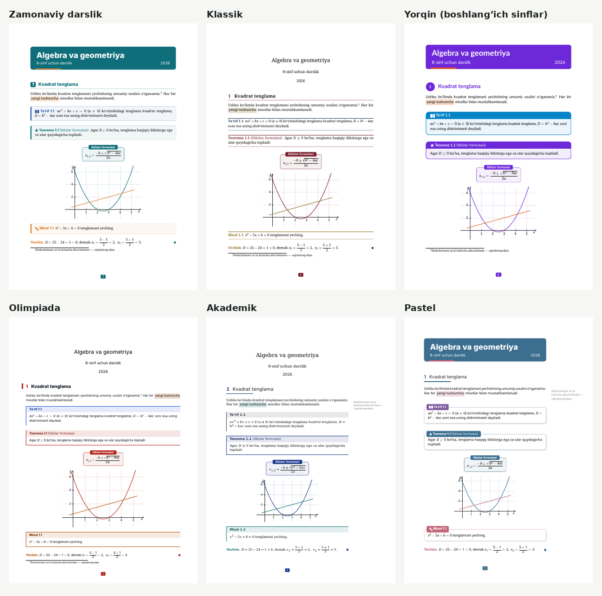

# Oversells

**Oversells** is an online LaTeX editor — in the spirit of Overleaf — built for
teachers and educational publishers. It puts first-class support for **Uzbek
(Latin and Cyrillic)** textbooks and mathematical content at the centre:
new projects start from a textbook template that compiles out of the box with
XeLaTeX/LuaLaTeX, Uzbek letters (oʻ, gʻ, ʼ, ў, қ, ғ, ҳ), `amsmath`, `tikz`
and `pgfplots`.

> **Status: Phase 5 — designs.** Beautiful book designs for formulas,
> boxes and drawings (see [Designs](#designs)). **Phase 4:** SyncTeX, spell checking (Uzbek Latin/Cyrillic,
> Russian, English), optional AI help, an admin panel and a production setup
> (compile workers, S3 storage, several app instances, HTTPS with Caddy) on
> top of real-time collaboration (Phase 3), accounts and sharing (Phase 2) and
> the editor (Phase 1). See [PLAN.md](PLAN.md) for the architecture and the
> decisions, and [Production deployment](#production-deployment) before
> exposing it to the internet.

## Features

**Designs (Phase 5)**

- **Six ready designs** — *Zamonaviy darslik*, *Klassik*, *Yorqin
  (boshlangʻich sinflar)*, *Olimpiada*, *Akademik*, *Pastel* — each a
  matching set of fonts (text, headings and formulas), colours, section
  headings, coloured boxes, page headers and drawing styles. "🎨 Dizayn" in
  the editor shows a gallery with real compiled samples; one click applies a
  design to the project (box titles in Uzbek Latin, Uzbek Cyrillic, Russian or
  English) and rebuilds the PDF.
- **Your own design**: start from any design, change fonts, colours and
  styles, and watch the live sample update; save it and reuse it in all your
  projects.
- **Design from your book** (with the AI assistant): upload a few pages of an
  existing book (PDF or photos) and get a similar design to fine-tune.
- **Beautiful maths**: OpenType maths fonts matched to the text font (letters
  in formulas can use the text font itself), highlighted key formulas, numbered
  theorem/definition/example boxes, exercises with difficulty stars and answer
  keys.
- **Drawings in the book's style**: coordinate planes and function graphs,
  triangles with angle marks, circles, number lines with intervals, fraction
  circles, Venn diagrams, vectors, squared paper — one click away in
  "📐 Chizma va formulalar", all in the design's colours.

**Power features (Phase 4)**

- **SyncTeX**: double-click in the PDF to open the source line; press "PDF"
  in the editor to see where the cursor line is in the PDF (highlighted).
- **Spell checking** while you type — Uzbek (Latin and Cyrillic), Russian and
  English, chosen per project ("Imlo"). LaTeX commands and formulas are
  ignored; right-click a red word for suggestions, "add to my dictionary"
  (kept in your account) or "ignore". Runs in the browser; no text is sent
  anywhere.
- **AI assistant** (optional, off unless the server enables it): "explain"
  any compile error in plain words, "suggest a fix" shown as a diff that you
  accept or reject, "generate exercises" on a topic, and "TikZ from a
  description" — answers in the interface language (uz/ru/en). Each user has
  a daily number of requests.
- **Admin panel** (`/admin`, for administrators): users with their usage,
  search, block/unblock, admin role, per-user limits (projects, storage, AI
  requests per day), compile statistics (per day, failures, average and p95
  time, queue) and storage usage.
- **Production setup**: compile workers separate from the web app, S3/MinIO
  storage, several app instances sharing live documents through Redis,
  automatic HTTPS with Caddy, health/readiness endpoints, Prometheus metrics,
  JSON logs, version retention, [backup guide](docs/BACKUPS.md).

**Working together (Phase 3)**

- **Real-time editing**: several people edit the same file at once (owner and
  people with an edit link); everyone sees the others' changes and cursors
  (with names) immediately. Viewers watch live, read-only.
- Changes are saved continuously; if the connection drops you keep typing and
  your edits are merged when it comes back ("Oflayn" in the toolbar).
- **Comments**: select text → "Izoh". Threads stay attached to their text
  while it is edited, can be answered, resolved and reopened.
- **History**: versions are saved automatically while you work (at most every
  10 minutes) and when everyone has left; save named versions ("1-bob tayyor");
  compare any version with the current state or the previous version; restore
  a version — the current state is kept in the history too.
- **Shared with me**: projects you opened through a link are listed on your
  project page (until the owner revokes the link).

**Accounts and sharing (Phase 2)**

- Sign up and log in with e-mail and password; log out; reset a forgotten
  password by e-mail.
- Every project belongs to its owner; other users cannot see it.
- Share a project with a link: **view** links (open, compile, download PDF and
  ZIP — no editing) or **edit** links (editing for logged-in users). Links can
  be revoked at any time.
- **Templates gallery**: textbook, worksheet, exam paper, multiple-choice test,
  olympiad (problems with points, solutions hidden with `\yechimlarfalse`),
  lesson plan (dars ishlanmasi), certificate and diploma (one page per name in
  the list; I, II, III degree medals), scientific article and a blank
  document — Uzbek-first, XeLaTeX, each compiles without errors; the
  gallery shows a preview of each template's first page.

**Editor (Phase 1)**

- Project list: cards on a warm background (a coloured letter, the compiler,
  «2 kun oldin»), a search box, create, rename, delete, download as ZIP.
- Multi-file projects: `.tex`, `.bib`, `.sty`, `.cls`, images (`png`, `jpg`,
  `pdf`, `eps`), fonts (`ttf`, `otf`), data files; folders; upload, rename/move,
  delete; choose the main file.
- The editor is a warm desk: files, code and PDF in rounded panels, soft
  pill buttons, a highlighted Compile button.
- **Pane sizes**: drag the border between files and code, or between code and
  PDF, to make a pane wider or narrower (double-click: the usual size); ‹ folds
  the file panel away. The tool buttons of the code pane are icons (the name
  shows on hover) and fold into one «🧰 Asboblar» button. All of it is kept in
  the browser.
- Code editor (CodeMirror 6) with LaTeX highlighting, command completion,
  search, per-file undo history and **auto-save**.
- **Compile** button (or `Ctrl/Cmd+Enter`): the PDF appears next to the
  editor; pdfLaTeX, XeLaTeX or LuaLaTeX per project.
- **Auto** (next to Compile, on by default): the PDF updates by itself a
  second after you stop typing. The editor learns that a compile finished the
  moment it does (long polling), not on the next poll.
- Readable errors and warnings with file and line — **click an error to jump to
  the line**. Full raw log available.
- Download the PDF.
- Interface in Uzbek (default), Russian and English (including e-mails).
- Security: every compilation runs in a throw-away Docker container with **no
  network**, read-only file system, CPU/memory/process limits, a 240 s time
  limit and shell-escape disabled. File paths and names are validated
  (no path traversal), uploads are limited by size and type.

## Requirements

- **Docker** with Docker Compose v2.24+ (Docker Desktop on Windows/macOS, or
  Docker Engine on Linux). This is all you need to run Oversells.
- About **3 GB** of free disk space (the TeX Live image is ~1.7 GB).
- For development without Docker for the app itself: **Node.js 22+** and npm.
  Compilation always needs Docker.

## Run it (one command)

```bash
git clone <this repository> oversells
cd oversells
cp .env.example .env        # optional, the defaults work
docker compose up --build
```

The first start downloads Ubuntu/TeX Live packages and builds two images; this
takes several minutes. When `docker compose ps` shows `app` and `worker` as
healthy, open **http://localhost:3000** and create an account
("Roʻyxatdan oʻtish").

To become an administrator, put your e-mail in `.env` before registering (or
restart afterwards): `ADMIN_EMAILS=you@example.uz`. The "Boshqaruv" button then
appears next to your name.

To enable the AI assistant, add to `.env` and restart:

```bash
AI_ENABLED=true
ANTHROPIC_API_KEY=sk-ant-...        # from https://console.anthropic.com
AI_DAILY_LIMIT=30                   # requests per user and day
```

When `AI_ENABLED` is not `true`, the AI buttons are hidden and the server
never sends anything to the AI provider.

### Accounts, e-mail and projects from Phase 1

- **E-mail**: without SMTP settings, password reset e-mails are printed to the
  app log — find the link with `docker compose logs app | grep reset-password`.
  To really send e-mails set `SMTP_HOST`, `SMTP_PORT`, `SMTP_SECURE`,
  `SMTP_USER`, `SMTP_PASS` and `MAIL_FROM` in `.env`, and `APP_URL` to the
  address people use to open Oversells (it is used in the links).
- **Projects created with Phase 1** (before accounts existed) were moved to a
  placeholder account by the database migration. To get them back, add to
  `.env`:

  ```bash
  DEFAULT_OWNER_EMAIL=you@example.uz
  DEFAULT_OWNER_PASSWORD=a-long-password
  ```

  and restart (`docker compose up -d`). You can then log in with that e-mail
  and password (if you already registered with that e-mail, the projects are
  moved into your account). Remove the two lines afterwards.
- **Sharing**: open a project → "Ulashish" → create a view or edit link and
  send it. Anyone with a view link can read and compile; an edit link lets
  logged-in users edit. "Bekor qilish" revokes a link immediately.

- Stop: `Ctrl+C`, or `docker compose down`.
- Data lives in the Docker volumes `oversells_db-data` (database) and
  `oversells_minio-data` (files, PDFs); `docker compose down -v` deletes it.
  Upgrading from Phase 1–3, your files are still in the old `oversells_app-data`
  volume: copy them into MinIO once as described in
  [docs/BACKUPS.md](docs/BACKUPS.md#moving-from-local-storage-to-s3).
- Port 3000, 5432 or 9000 taken? Set `APP_PORT`, `DB_PORT` or `MINIO_PORT` in
  `.env`. The MinIO console is on http://localhost:9001.

What `docker compose up` starts:

| Service | What it does |
|---|---|
| `db` | PostgreSQL 16 (data and the compile queue) |
| `redis` | Messages between app instances (live documents), rate limits |
| `minio` | S3-compatible storage for files and PDFs (`MINIO_IMAGE` to use another image) |
| `compiler` | Builds the `oversells-texlive` sandbox image, then exits (this is expected) |
| `app` | API server + web interface on port 3000; no access to Docker |
| `worker` | Compile worker: takes queued compiles and runs each in a sandbox container through the Docker socket; renders template previews |

## Designs



A design is a generated LaTeX package, `dizayn.sty`, that lives in the
project like any other file and is loaded with `\usepackage{dizayn}` (the
editor adds both). It works with XeLaTeX and LuaLaTeX (pdfLaTeX keeps the
boxes and drawings without the design fonts). New projects from the
textbook, worksheet, olympiad and article templates start with a design.

What the package gives you (names are Uzbek, titles follow the chosen
language):

| Kind | Commands |
|---|---|
| Boxes | `teorema`, `lemma`, `natija`, `tarif`, `misol` (numbered, optional `[name]`), `eslatma`, `diqqat`, `bilasizmi`, `tarix`; `isbot`, `yechim` (end mark) |
| Formulas | `\muhim[Title]{a^2+b^2=c^2}` (highlighted display), `\belgila{text}`, `\yon{side note}` |
| Exercises | `\begin{mashqlar} \item ... \daraja{1..3} \end{mashqlar}`, `\begin{javoblar} ... \end{javoblar}` |
| Graphs | `\begin{koordinata}[xmin=..,xmax=..,ymin=..,ymax=..] \addplot[domain=a:b] {f(x)}; \end{koordinata}` |
| Drawings | `\begin{chizma} ... \end{chizma}` with `\nuqta{(x,y)}{A}`, `\uchburchak{A}{(0,0)}{B}{(4,0)}{C}{(1,3)}`, `\burchak{B}{A}{C}{\alpha}`, `\togriburchak{B}{A}{C}`, `\vektor{(0,0)}{(2,1)}{\vec a}` |
| Number line | `\begin{sonoqi}{-3}{5} \sonnuqta{2}{A} \oraliq{-1}{3} \end{sonoqi}` (`\oraliq*` = open ends) |
| Pictures | `\kasrdoira{3}{8}`, `\venn{A}{B}` |
| Styles/colours | TikZ styles `dz asosiy`, `dz urgu`, `dz yordamchi`, `dz soha`, `dz nuqta`, `dz katak`; colours `dzAsosiy`, `dzIkkinchi`, `dzUrgu`, `dzSiyoh` |

`designs/showcase/main.tex` (in `apps/server`) uses all of them; it is what
the gallery shows. To add a built-in design, put a JSON file next to the
others in `apps/server/designs/`. The fonts come with the compiler image
(Noto, DejaVu, Inter, Lato; Latin Modern; the TeX Gyre text fonts, by name or
by file name as in `\setmainfont{texgyreheros}[Extension=.otf,...]`; TeX Gyre
Pagella and DejaVu maths). A font that is not installed (`Times New Roman`,
`Calibri`) is reported in plain words, and **Tuzatish** in the log puts a
similar installed font (Noto Serif, Noto Sans, DejaVu Sans Mono) in its
place, keeping the old line as a comment.
After pulling this version rebuild it once: `docker compose build compiler`.
Where Docker Hub cannot be reached (`failed to fetch oauth token ...
connection refused`), `sh desktop/add-fonts.sh` adds the TeX Gyre fonts to
the compiler image already on the computer instead (it needs only the Ubuntu
package mirror), and the macOS app opens the previous version when a rebuild
fails.

## On your own computer, as an app

For one person on one computer, free (Docker Desktop is free for personal
use and small organisations):

1. Install [Docker Desktop](https://www.docker.com/products/docker-desktop/)
   and download this repository (Code → Download ZIP, unpack it).
2. Double-click **`desktop/Oversells.bat`** (Windows) or
   **`desktop/Oversells.command`** (macOS; Linux: `desktop/oversells.sh`).
   The first start builds everything (15–30 minutes); later starts take seconds.
3. Oversells opens in its own window. To get a desktop icon, in Edge or Chrome
   choose "Install Oversells" (⋮ → Apps / Cast, save and share → Install).

**macOS app with an icon:** run `bash desktop/mac/install-app.sh` once. It
creates `~/Applications/Oversells.app` (Launchpad, Spotlight, Keep in Dock).
Clicking it starts Docker Desktop if needed, starts Oversells, shows a
notification while it starts and opens it in its own window (Chrome `--app`
when Chrome is installed, otherwise the default browser). The log is in
`~/Library/Logs/Oversells.log`. Run the script again after moving the folder.

It uses `docker-compose.desktop.yml`: only this computer can open it
(`127.0.0.1:3000`), projects are kept in Docker volumes, and it starts again
with Docker Desktop. `desktop/Oversells-toxtatish.bat` stops it. Put
`ADMIN_EMAILS=you@example.uz` (and optionally the AI settings) into a `.env`
file next to `docker-compose.desktop.yml`.

**Without Docker Hub:** when a rebuild cannot reach Docker Hub (`failed to
fetch oauth token ... connection refused`), the launchers run
`sh desktop/update-offline.sh`, which builds the new version on top of the
app image already installed (it holds Ubuntu and Node.js; only the Ubuntu and
npm mirrors are needed). It always builds on the same base
(`oversells-app:offline-base`), so the images do not grow with every update.
Run it by hand after `git pull`; rerun `desktop/mac/install-app.sh` once to
give the macOS app this fallback.

### On a phone or tablet

`sh desktop/phone.sh on` opens Oversells to the devices on the same Wi-Fi
(`OVERSELLS_BIND=0.0.0.0` in `.env`) and prints the address to open there,
e.g. `http://192.168.1.20:3000`; `sh desktop/phone.sh off` closes it again.
Everyone still logs in with their own password; the computer has to be on.
On a narrow screen the editor shows one pane at a time, switched from the bar
at the bottom (📁 files, ✏️ code, 📄 PDF, ▶ compile): opening a file shows the
code, compiling shows the PDF and its log, and ⬇ PDF comes first in the top
bar. The connection is plain HTTP inside the home network; for use away from
home, put Oversells on a server with HTTPS instead (below).

### Who is in which file

A coloured dot next to a file in the tree means someone else has it open
(hover: their names), refreshed every few seconds from the live editing
sessions (`GET /api/projects/:id/presence`). Nothing is locked: Yjs merges
simultaneous edits without losing any, so the dot is a hint to talk before
rewriting the same chapter. Inside a file, the names of the others and their
cursors are shown as before; the history shows who saved each version. With
several server instances, a file open only on another instance shows no dot.

### Pictures: drop, paste, ready for print

Drop a picture into the code editor or paste a screenshot (Ctrl+V): it is
uploaded to `rasmlar/` next to the main file and
`\includegraphics[width=0.8\linewidth]{rasmlar/...}` is inserted where it was
dropped (with `\usepackage{graphicx}` when nothing loads it). Before the
upload, in the browser: photos larger than 3000 px are scaled down (they
still print at 300 dpi over 25 cm, and books compile faster), WebP/GIF/BMP
become PNG (LaTeX cannot read them), names become LaTeX-friendly
(`Uchburchak chizma (1).PNG` → `uchburchak-chizma-1.png`), and a picture that
would print below 150 dpi gets a warning. Uploads from the file tree are
scaled the same way and keep their names.

### Errors explained in Uzbek, fixed with one click

Under each error and warning of the log, a short explanation in the user's
language says what happened and how to fix it (about 45 kinds: undefined
commands and environments, braces and `$`, `&` and `#` in text, mismatched
`\begin`/`\end`, missing files and packages, undefined references, ...;
`explainError` in `packages/shared`). Where the fix is certain, a 🩹 button
applies it and compiles again: the package of a command or environment into
the preamble (`\includegraphics` → graphicx, `align` → amsmath), a typo
(`\frca` → `\frac`), the Uzbek `\tg`, `\ctg`, ... declared, `\newcommand` →
`\renewcommand`, `&` → `\&`, `#` → `\#`, a missing `\end{document}`. It works
offline; the AI explanation stays an extra.

### Faqat shu bob (one chapter, in seconds)

**📖 Faqat shu bob** next to the compile button compiles only the chapter
with the cursor: an 800-page book shows one chapter in seconds. Chapters start
with `\part`, `\chapter`, `\addchap` or a command of the document that opens
one (its definition clears to a new page and steps a counter, or adds a chapter
to the contents: `\bob` in a book design); documents without chapters use a
command that starts a topic on a new page (`\mavzu` of a workbook: `\clearpage`
and a section in the contents), else `\section`. Definitions made in the body
(a `\newcommand` over several lines between topics) are kept. In a file that is `\input` into the main file, the chapter that
inputs it is shown. The chapter keeps its number and line numbers (other
chapters' lines become empty lines in a `main-bob.tex` compiled next to
`main.tex`), so errors and SyncTeX point at the real file. A strip over the
PDF names the chapter; **Butun kitob** compiles the whole document. The switch
is remembered per project.

### The right compiler, from the preamble

Books written elsewhere (Overleaf, older books) often use pdfLaTeX font
setup: `inputenc`, `fontenc` with T1/T2A, `mathpazo`, `helvet`, ... Compiled
with XeLaTeX, those fonts lose every Cyrillic letter and oʻ/gʻ. Oversells reads
the main file's preamble (`detectCompiler` in `packages/shared`): a restored
project ZIP gets the right compiler, and the editor shows a banner over the
PDF ("Bu hujjat pdfLaTeX uchun yozilgan") with a button that switches the
compiler and compiles again. `fontspec`/`unicode-math`/`polyglossia` mean
XeLaTeX or LuaLaTeX, `luacode`/`\directlua` LuaLaTeX, and a
`% !TEX program = ...` line decides first.

### Letters missing from the PDF

A document without `fontspec` uses Latin Modern, which has no Cyrillic and
no ʻ ʼ: XeLaTeX and LuaLaTeX silently leave those letters out, and pdfLaTeX
stops with "Unicode character … not set up". Oversells reports which letters
are missing (one warning per font) and shows a banner over the PDF; its
**Tuzatish** button switches pdfLaTeX projects to XeLaTeX and adds
`\usepackage{fontspec}` with Noto Serif, Noto Sans and DejaVu Sans Mono right
before `\begin{document}`, commenting out pdfLaTeX font lines (`inputenc`,
`fontenc` with T1/T2A, `lmodern`), whose 8-bit fonts lose every Cyrillic
letter under XeLaTeX; then it compiles again. When the document already uses
fontspec, only the families that lack letters get a new font. A pdfLaTeX
document that only lacks ʻ and ʼ keeps its compiler and fonts: Tuzatish adds
`\DeclareUnicodeCharacter{02BB}{\textquoteleft}` and `{02BC}{\textquoteright}`
(the compiler image already knows them; the lines make the file work in any
TeX Live, e.g. on Overleaf). Letters inside formulas need `\text{...}`; the banner says so.

### Drawing with the mouse

**Chizish** (in a .tex file) opens a drawing board: points (named A, B, C, …),
segments, vectors, polygons, rectangles, circles, text, and graphs of
functions typed as teachers write them (`2x^2-3x+1`, `sin 2x`, `sqrt(x+1)`,
`1/x`, `|x|`, `e^x`, `ln x`), with axes, a grid, snapping, colours, thick,
dashed and filled lines. **Insert** puts the TikZ code at the cursor (and
`\usepackage{tikz}` into the main file). The code starts with a
`% oversells-drawing:` comment: with the cursor inside the picture, **Chizish**
opens it again for editing. Graphs are split where the function is not
defined or jumps (1/x, tan x), so there are no false vertical lines.

### Backups

The desktop app writes a ZIP of all projects every day to
`Documents/Oversells zaxira` (`oversells-YYYY-MM-DD.zip`, kept 14 days;
`BACKUP_DIR` and `BACKUP_KEEP_DAYS` on a server). Tip: put that folder
inside a Google Drive, iCloud or Dropbox folder (or point
`OVERSELLS_BACKUP_DIR` there) and the backups also leave the computer. On the
projects page, **Download all** gives a ZIP of your projects and **Restore**
turns a backup ZIP (or a ZIP of one project folder) back into projects; the
existing projects are not touched.

### Index in Uzbek alphabetical order

With `\usepackage{imakeidx}\makeindex` in the preamble, `\index{...}` in the
text and `\printindex` at the end, Uzbek documents get their index sorted
by the Uzbek alphabets (a b d e … z oʻ gʻ sh ch ng; а б в … я ў қ ғ ҳ) with
letter headings, by `oversells-index` (`compiler/oversells-index.pl`) instead
of makeindex, which does not know them. Other documents use makeindex. The
compiler image also fills babel's empty Uzbek captions (Mundarija, Rasm,
Jadval, Koʻrsatkich, Isbot, …; Мундарижа, Расм, …).

### Formula from a picture (AI)

**📷 Rasmdan** (editor, when AI is on): paste a screenshot (Ctrl+V), drop or
choose a picture (PNG/JPEG/WebP, up to 5 MB) of a formula or of a page with
formulas; Claude transcribes it into LaTeX, which you can correct and insert
at the cursor (as `\[ ... \]` or as text with `$...$`). Counts as one AI
request of the daily limit; pictures are not stored.

### Latin ↔ Cyrillic

**🔤 Кирилл / Lotin** (editor) converts the whole project between the two
Uzbek alphabets by their official rules (sh ш, ch ч, oʻ ў, gʻ ғ, ʼ ъ,
ye/yo/yu/ya е/ё/ю/я, word-initial e э, ц → s/ts, сҳ → sʼh...). Only text
changes: commands, formulas (also in `\muhim{...}`), labels, file names,
`\texttt`, the preamble (except `\title`, `\author`, `\date`) stay. The
main language in babel, the spell-check language and the design's titles
follow; a named version is saved first, so History can undo it.

**Ö Ğ Ş Ç** (editor) writes the project with the new letters: oʻ → ö, gʻ → ğ,
sh → ş, ch → ç (Oʻ → Ö, Gʻ → Ğ, Sh/SH → Ş, Ch/CH → Ç); sʼh (Isʼhoq) stays.
Cyrillic passages in a Latin project stay as they are; a Cyrillic project
is taken to Latin first.
The same rules decide what is text, and the labels of TikZ nodes and option
lists (`\draw[dashed]`, `[shift=...]`) are told apart, so drawings keep
working. The project's language becomes «Özbekça (Ö Ğ Ş Ç)»: spell checking
reads ö/ş as oʻ/sh, the design's titles are written in the new letters
(Maşqlar), and exercises and drawings from the AI arrive in them. The button
then reads **Oʻ Gʻ Sh Ch** and converts back.

The interface itself is in the new letters too: the language menu has
**Özbekça** (the default for a new browser, made from the Uzbek texts at
load time: placeholders, `code`, \commands and file names stay) next to
**Oʻzbekcha**, Русский and English. Template and design names, the
completion hints and the AI's explanations follow, and the password reset
e-mail is written in the letters of the page it was asked from.

All features, in Uzbek with the new letters:
[docs/imkoniyatlar/oversells-imkoniyatlari.pdf](docs/imkoniyatlar/oversells-imkoniyatlari.pdf)
(source: `oversells-imkoniyatlari.tex`, XeLaTeX).

### Sahifa dizayni (page design)

On for everyone (a server can hide it again with `PAGE_DESIGN_ENABLED=false`;
projects keep their files either way). **📰 Sahifa** in the editor opens a
panel next to the code (it stays usable) with:

* **Paragraph and character styles**: font (installed or uploaded), size,
  leading, tracking, alignment, indents, spacing, italic/bold/colour, no
  hyphenation, keep with next; styles inherit (`basedOn`); a style can format
  the level-1–3 headings. **Qoʻllash** puts the selected paragraphs into
  `\begin{uslub}{id} … \end{uslub}` or the selected text into
  `\matnuslubi{id}{…}`; changing a style changes it everywhere.
* **Master pages**: left/centre/right running heads and feet for odd and even
  pages (page number, chapter, section, book title, text), a head rule,
  page numbers that restart as 1/i/I; one master for the start of the book,
  one for chapter pages; `\sahifausta{id}` switches masters in the text.
* **Book rules**: chapters on odd pages, blank pages before them without
  heads, no widows/orphans.
* **Page and typography**: inner/outer/top/bottom margins, the gap of
  `\begin{ustunlar}{n}` columns, microtype, drop caps (2–4 lines, lettrine),
  space between paragraphs inside a style (stanzas).
* **Picture frames** (tab «Rasm»): `\rasmramka[keys]{file}{caption}` in the
  text (`joy=oqim`), with the text flowing around it (`oralash`, wrapfig),
  fixed at x, y on the page it is placed on (`sahifa`; the page comes from a
  zref label, settled on the second run), or a whole page cover-filled to the
  bleed (`tola`); `kesish=` crops without touching the file.
* **Preflight** (tab «Preflight»): the latest PDF is checked in the compile
  sandbox with poppler (`pdfinfo`, `pdffonts`, `pdfimages -list`,
  `pdftotext`; the script is sent with the job, so the compiler image is not
  rebuilt): fonts not embedded, pictures under 300/150 dpi, RGB pictures,
  page count not a multiple of 16/32 (one click adds `\bosbet` pages), lines
  over 1pt into the margin (click: the source line), pages with neither text
  nor pictures, pages with only a line or two of text, and pictures to the
  edge (`tola`, `fon`, `yoyilma`) in a PDF without room for bleed (no crop
  marks). A compile still running is waited for.
* **Dropping pictures** in visual mode: a picture dragged from the file tree
  (or the computer: uploaded to `rasmlar/`) onto a PDF page becomes
  `\rasmramka[joy=sahifa,x=,y=]` at that point, written after the line
  SyncTeX gives for it, so the frame lands on that page.
* **Visual mode** (📐 Vizual): over the PDF, the text block of every page
  (dashed) and the frames fixed on the page (`joy=sahifa`). Dragging an edge
  of the text block sets that margin (inner/outer swap on even pages of a
  two-sided book) in `sahifa.sty`; dragging a frame or its corner rewrites
  only `x=`, `y=`, `en=` of that `\rasmramka` in its file; then the PDF is
  compiled again. The positions come from lines `sahifa.sty` writes into the
  log (`OVS-G1/G2` page, `OVS-FL/FP` frames, the last LaTeX run wins); with
  crop marks they are measured from the trimmed page. To apply a style from
  the PDF, double-click the paragraph (the cursor jumps there) and press
  «Qoʻllash». Only frames fixed on the page (`joy=sahifa`) and text boxes move;
  a frame in the text flow is never changed by a drag.
* **Character styles on the PDF** (visual mode): the pages get pdf.js's text
  layer, so text can be selected on the PDF with the mouse; a small bar under
  the selection offers the design's character styles. «Qoʻllash» asks SyncTeX
  for the source line, finds the selected text near it (line breaks, `~`,
  words broken at line ends, ligatures and ʻ/ʼ/' told apart from what the
  source has; never in a comment) and wraps it in `\matnuslubi{id}{…}` in the
  shared document, then compiles. Text inside a command is not found: the
  bar says so, and the code editor's «Qoʻllash» still works.
* **Frames across the gutter**: a `joy=sahifa` frame on a left-hand page of a
  two-sided book that is wider than what is left of the page (x + en > paper
  width) is cut at the gutter, and the rest is drawn at the same height on
  the facing right-hand page (each part clipped to its page).
* **Background pictures and text boxes**: `\rasmramka[joy=fon]{file}{}`
  fills the current page to the bleed under its text; `\begin{matnquti}[x=,y=,
  en=,fon=RRGGBB,shaffof=0.2] … \end{matnquti}` puts a text box at x, y on the
  page (half-transparent fill) and can be dragged in visual mode like a frame.
* **Master backgrounds**: each master can draw coloured areas, lines and
  pictures under its pages (mm from the top-left of the trimmed page;
  mirrored on left-hand pages if asked), switched with `\sahifausta`; blank
  pages before chapters and `\bosbet` get none.
* **Spread picture**: `\rasmramka[joy=yoyilma]{file}{}` lays one picture
  over two facing pages (left half, right half; bleed on the outer edges,
  none in the gutter); two-sided books start it on an even page.
* **Chapter-head ornament** under every chapter title (titlesec after-code;
  with the class's own heading look when no level-1 style is defined).
* **Chapter-end ornament** (`* * *`, a short rule or a fleuron), placed
  before every chapter after the first and at the end of the book
  (`\bobbezagi`; top-level sections in classes without chapters).
* **Baseline grid** (▤ in visual mode): the baselines of the body text drawn
  over the text block, from `\topskip` and `\baselineskip` in the log.
  **Snap to the baseline grid** (book tab): spaces before and after styles
  and headings become the nearest whole number of body lines, leadings of
  styles and headings are rounded up to whole lines, a picture in the flow
  and its caption are padded to whole lines, and after every heading the next
  line is moved onto the grid using `\pagetotal` (the measured position, not
  an estimate: titlesec adds a few points of its own). Measured on a test
  page: body lines after headings, styles and pictures stay within a point of
  the grid (3–10 pt off without it). Formulas and tables can still break it.
  The IDML export turns on InDesign's own baseline grid for such a design.
* **Cover designer** (tab «Muqova»): the whole spread (back, spine, front)
  in `muqova.tex`, compiled into its own PDF («Muqova PDF», the project keeps
  its main file). The spine is sheets × paper thickness: newsprint, offset,
  coated gloss/matt and bulky book paper with typical thicknesses (±10 %
  between mills), or the exact value from the printing house; the page count
  comes from the last PDF. Soft glued, saddle-stitched and hard covers (boards,
  joints, turn-in), bleed, crop and fold marks, CMYK, the ISBN barcode on the
  back, pictures cover-filled into the panels; warnings for a spine too thin
  for text and for staples on thick books. Preflight compares `muqova.tex`
  with the book: when the book's page count changed since the cover was made,
  the spine is wrong (an error from half a millimetre), and «Muqovani N betga
  moslash» makes the cover again for the new count.
* **AI design from a description** (book tab, when AI is on): the model
  answers in a JSON schema (styles, margins, running heads, ornaments; no
  fonts), the answer is checked and cleaned into a page design and shown as a
  proposal; nothing is written until it is accepted and saved. With pages of
  a sample book attached (PDF or photos, up to 5), the design is taken from
  them instead.
* **Merging styles** (styles tab, «Boshqa uslubga qoʻshish»): one paragraph or
  character style into another, e.g. Word's «Quote» into «Iqtibos» after an
  import: every use in the project's `.tex` files changes, the style leaves
  `sahifa.sty`, styles based on it are based on the other one.
* **PDF text import** («📕 PDF'dan matn»): `pdftotext -layout` in the sandbox,
  then paragraphs from indents and blank lines, running heads and page numbers
  dropped (lines repeated at page edges), words broken at line ends mended
  (doubled words like «bir-biri» keep the hyphen), headings guessed
  (`\section*`). Text only; a scanned PDF has none.
* **InDesign import** («📐 InDesign'dan import» on the project list): an
  `.idml` becomes a project. Its stories are read in the order of their
  frames on the spreads; paragraph and character styles (size, leading,
  alignment, indents, spacing, bold/italic, colour, drop caps, based-on) go
  into `sahifa.sty`, `Heading/Sarlavha/Заголовок 1–3` styles become
  `\section`…, footnotes `\footnote`; page size and the first master's
  margins are kept (in a facing-pages document from the master's right-hand
  page). Running heads on masters are not body text. Linked pictures (also
  inline ones in the text) and fonts (not inside an IDML) are listed at the
  top of `main.tex`; tables keep only their text. The XML is read in Node
  with a small parser, only `.xml` parts are unpacked (≤ 100 MB).
* **InDesign export** («⬇ InDesign» in the editor): the project as an `.idml`
  for InDesign (checked with InDesign 2026, 21.2). `main.tex` with its
  `\input`/`\include` files becomes one text story threaded through a frame on
  every page; paragraph styles (`\begin{uslub}`), character styles
  (`\matnuslubi`), bold/italic/small caps, lists, quotes, captions and
  footnotes go over as InDesign styles and footnotes; `\chapter`/`\section`…
  become «Sarlavha 1–3» (formatted by the design's heading styles; chapters
  start on a new or odd page); the page size, margins and facing pages come
  from the preamble, `bosma.sty` and `sahifa.sty`; every master becomes an
  InDesign master with its running heads and feet (page number, chapter and
  section through text variables, book title, text, head rule). Pictures are
  inline frames sized from the file (pixels and ppi) and linked to
  `Links/<name>`: a project with pictures (or uploaded fonts, put into
  «Document fonts») downloads as a `.zip` to unpack next to each other.
  Formulas become readable text where they can (x², √D, ±, ∫₀¹, Greek
  letters) in the «Formula (LaTeX)» character style; TikZ drawings leave
  `[Chizma]`, tables their cells separated by tabs; the editor says how many.
  **InDesignʼda ochish** (the desktop app on a Mac with InDesign): one click
  opens the project in InDesign. `desktop/mac/install-app.sh` also installs a
  small windowless helper, `~/Applications/Oversells InDesign.app`, for
  `oversells-indesign://` links (only when InDesign is in `/Applications`).
  The button asks the server for a one-time ticket (random, for that
  project, valid two minutes, used once); the helper downloads the package
  with it from `127.0.0.1` (no login: it is not the browser), unpacks it into
  `~/Documents/Oversells InDesign/<project>/` (files of other names there,
  e.g. an `.indd` you saved, are kept) and runs `open -a` with the newest
  InDesign. The helper takes nothing but the ticket from the link. The
  launchers write `desktop/state/indesign` (mounted read-only into the app)
  when the helper and InDesign are there, and the button shows only then and
  only in a browser on that Mac (not on a phone through `phone.sh`). The
  first time, the browser asks to open «Oversells InDesign».
  The pages are counted from the last PDF and the text (15 % to spare);
  InDesign's Smart Text Reflow adds pages if the fonts set longer. Fonts the
  computer lacks (e.g. Noto Serif of the templates, free from Google Fonts)
  are reported by InDesign as missing. The export reads back through the
  IDML import (tested).
* **Picture grid**: `\begin{rasmtori}[ratio]{n}` with `\torrasm{file}{caption}`
  puts n pictures a row, all cut to the same height (width × ratio).
* **Workbook helpers**: `\yozishchiziqlari{n}` (writing lines),
  `\javobjoyi[h]` (an answer box), `\katakjoy[h]` (squared paper).
* **Word import with styles**: with the flag on, «Wordʼdan import» keeps the
  document's own paragraph and character styles (pandoc `docx+styles` and a
  Lua filter sent with the job): they become `\begin{uslub}{id}` /
  `\matnuslubi{id}{…}` in `main.tex` and styles named as in Word in
  `sahifa.sty`, ready to be designed. Headings, normal text, lists and
  captions stay plain LaTeX.
* **Templates** «Roman, nasr», «Sheʼriyat», «Bolalar rasmli kitobi» (square
  pages, full-page pictures under text boxes), «Iş daftari» (writing lines,
  answer boxes, squared paper) and «Diniy matn (arabcha)» (LuaLaTeX, XeLaTeX too: Arabic
  right to left in Amiri beside the Uzbek translation with paracol, verse
  numbers in ornate brackets), «Lugʻat» (two columns, the first and last
  headword of the page in the running head), «Oshpazlik kitobi» (picture,
  time and servings, ingredients beside the method), «Fotoalbom» and
  «Katalog» (picture grids, product cards), listed only with the flag: their `sahifa.json`
  model becomes `sahifa.sty` when a project is created.

Everything is kept in `sahifa.sty` (the model in `% oversells-sahifa:`
comment lines, the LaTeX generated from it), loaded with
`\usepackage{sahifa}`; it compiles with XeLaTeX, LuaLaTeX and pdfLaTeX
(pdfLaTeX without the fonts; Uzbek ʻ ʼ in running heads are set up). A
hand-written `sahifa.sty` is never overwritten silently, and a file saved
with Windows line ends still reads. When `sahifa.sty` changed after the
panel opened (a margin dragged in visual mode, a colleague's save), «Saqlash»
asks whether to write over it or load the newer design. Accepting an AI
proposal keeps the styles and masters the text already uses. Style and master ids survive Latin ↔ Cyrillic and
Ö Ğ Ş Ç conversion. The full specification and roadmap:
[docs/sahifa-dizayni/sahifa-dizayni.pdf](docs/sahifa-dizayni/sahifa-dizayni.pdf).

### For the printing house

**🖨 Bosmaxona** (editor) writes `bosma.sty` and loads it right after
`\documentclass`: the PDF gets a book format (60×84/16 = 145×200 mm,
70×100/16, 84×108/32, A5, B5, A4), crop marks around the trimmed page and
CMYK colours (pictures keep their own colours). With an ISBN-13 it also draws
the EAN-13 barcode, and

```latex
\nashrmalumotlari{muallif=..., nomi=..., turi=darslik, uok=..., kbk=...,
  nashriyot=..., sana=14.10.2026, adadi=1000, buyurtma=...}
```

prints the publication data page (UOʻK, KBK, format, conventional printed
sheets computed from the page count, run, ISBN and its barcode). PDF/X
conversion and bleed for pictures that reach the page edge are left to the
printing house's own tools.

### Tests with variants

Write a question bank (the **Test** template has one: `savollar.tex`):

```latex
\begin{savol}
  $2+3\cdot 4$ ni hisoblang.
  \togri{$14$}      % the right answer
  \variant{$20$}    % other answers (2-6 in all)
  \variant{$24$}
\end{savol}
```

**📝 Test** (editor toolbar) writes `test.tex` and `testlar.sty` and makes
`test.tex` the main file: variants A, B, C... (questions and answers shuffled
from a seed), an answer sheet with bubbles and an answer key. Questions
without exactly one `\togri` are skipped and their lines reported.

Answers are laid out by `testlar.sty`, which measures them in TeX: all in one
row when they fit (4 or 5 short answers), else two per row, else one per row,
every row aligned under the question. The dialog can also leave space for the
working after each question (1.5, 3 or 5 cm) and put a QR code with a link of
your choice (an answers page, a Telegram post) under the answer sheet.

### Word and EPUB

* **Word'dan import** (projects page): upload a `.docx`; text, headings,
  lists, tables, formulas (Word equations become LaTeX maths) and pictures
  (`media/`) become a new project that compiles with XeLaTeX.
* **⬇ Word / ⬇ EPUB** (editor): the project as a Word document or an
  e-book. Text, headings, lists, tables, pictures and formulas are kept;
  TikZ drawings and the design's styling are not (they need LaTeX).
* Conversions run pandoc in the same locked-down container as compiles
  (`compiler/run-convert.sh`).

### Big books

Oversells handles books of 1000 pages and more:

* The PDF viewer draws only the pages you are looking at; type a page number
  in the box above the PDF to jump there.
* After the first compile the next ones reuse the table of contents and
  references of the previous run, so usually only one LaTeX pass is needed
  (a 1000-page book: about 1.5 min the first time, about half a minute after
  an edit).
* The desktop setup allows compiles of up to 30 minutes, projects of 1 GB and
  text files of 16 MB (`COMPILE_TIMEOUT_MS`, `MAX_PROJECT_BYTES`,
  `MAX_TEXT_FILE_BYTES`, ... in `.env` change this).
* Tip: keep each chapter in its own file (`\include{bob1}`) and, while
  writing one chapter, compile only it with `\includeonly{bob1}` in the
  preamble; page numbers and references of the other chapters are kept.

## Your own server (one person)

The cheapest way to have Oversells always available: a small VPS
(Ubuntu 24.04, 2 CPUs, 4 GB RAM, 40 GB disk) and one command:

```bash
git clone https://github.com/toshpolatovbehruz749-blip/Oversells.git
cd Oversells
sudo bash deploy/install.sh
```

The script installs Docker, adds swap, writes `.env.production` with random
passwords, uses a free HTTPS address `<server-ip>.sslip.io` unless you enter
your own domain, starts `docker-compose.single.yml` (Caddy, one app, the
compile worker, PostgreSQL; files on a local volume, no Redis/MinIO) and
schedules a daily backup into `backups/` (the database dump and an archive of
the files, kept 14 days; the app also writes a ZIP of all projects there);
how to restore: [docs/BACKUPS.md](docs/BACKUPS.md#one-person-server-deployinstallsh). The address you give becomes the admin. To
update: `git pull` and run the script again.

**Free server**: an Oracle Cloud «Always Free» Ampere (ARM) VM with Ubuntu
24.04 works too. Allow TCP 80 and 443 in the subnet's security list (Networking
→ Virtual cloud networks → the VCN → Security lists → Add ingress rules,
source `0.0.0.0/0`); the script opens them in the image's own iptables.

## Production deployment

`docker-compose.prod.yml` runs everything behind **Caddy**, which gets a
Let's Encrypt certificate for your domain automatically:

```bash
cp .env.production.example .env.production   # set the domain and the secrets
docker compose -f docker-compose.prod.yml --env-file .env.production up -d --build
```

- DNS for `OVERSELLS_DOMAIN` must point at the server, ports 80 and 443 open.
  Only Caddy is published; the database, Redis, MinIO and the apps stay on the
  internal network.
- `APP_REPLICAS` (default 2) app instances share live documents through Redis,
  so any instance can serve any browser; `WORKER_REPLICAS` workers share the
  compile queue (`COMPILE_CONCURRENCY` jobs each).
- Health: `GET /api/health` (liveness and compiler state), `GET /api/ready`
  (database, Redis, storage). Workers answer `/health` on port 9464.
- Metrics for Prometheus: set `METRICS_TOKEN` and scrape `http://app:3000/metrics`
  and `http://worker:9464/metrics` from inside the Docker network with
  `Authorization: Bearer <token>` (Caddy hides `/metrics` from the internet).
- Logs are JSON lines (`docker compose logs app`), with a request id that is
  also returned in the `X-Request-Id` header; cookies, tokens and passwords are
  redacted.
- Automatic versions are thinned out hourly: all from the last day, one per
  day for a month, then one per week; named versions are kept.
- **Backups**: see [docs/BACKUPS.md](docs/BACKUPS.md) — the database and the
  bucket must both be backed up.
- Updating: `git pull` and the same `up -d --build`; migrations run when the
  app starts.

## Development

```bash
npm install
docker compose up -d db                 # PostgreSQL only
npm run compiler:build                  # build the TeX Live sandbox image once
cp .env.example .env
npm run db:migrate                      # create the tables
npm run dev                             # API on :3000, web on http://localhost:5173
```

`npm run dev` runs the API with auto-reload (`tsx watch`) and the Vite dev
server, which proxies `/api` to port 3000. In development the defaults are
`COMPILE_MODE=inline` (the API compiles itself through the Docker socket),
`STORAGE_DRIVER=local` and no Redis, so nothing else is needed. To try the
production layout locally, set `COMPILE_MODE=queue` and run the worker in a
second terminal with `npm run dev:worker -w apps/server`; set `REDIS_URL` to
run two API processes on different ports.

The spell-check dictionaries are generated into `apps/web/public/dict/`
(`npm run dictionaries -w apps/web`; this also runs before `dev` and `build`).

Useful scripts (repository root):

| Script | Description |
|---|---|
| `npm run dev` | API + web in development mode |
| `npm run build` | Production build of web and server |
| `npm run typecheck` | TypeScript checks for all packages |
| `npm test` | Unit tests (shared, web, server) |
| `npm run test:e2e` | End-to-end tests (needs Docker and the compiler image) |
| `npm run compiler:build` | Build the TeX Live sandbox image |

## Tests

```bash
docker compose up -d db          # tests need PostgreSQL
npm test                         # unit tests
npm run compiler:build           # once, for the e2e tests
npm run test:e2e                 # API e2e + browser e2e
```

- **Phase 5 (designs)**: unit tests for the package generator (every option,
  titles in four languages, validation that keeps user input out of TeX),
  the designs API (previews and their cache, own designs, access, applying to
  a project), render jobs on the worker, the AI design from a book; an API e2e
  test compiles every built-in design's showcase and **every snippet** with
  XeLaTeX and LuaLaTeX in the sandbox and requires a log without errors,
  warnings or overfull boxes; a Playwright test goes through the gallery,
  applying a design, inserting snippets, a custom design with live preview and
  the design from a book (mocked AI).
- **Phase 4 unit tests**: the SyncTeX parser against the `synctex` command
  line tool's answers, the spell-check tokenizer and dictionary routing, the
  dictionary build, AI (disabled = no request and 404, prompts per language,
  quota under concurrency, access, provider errors and refusals; the SDK
  client against a local mock of the Messages API), the admin API (401/403/200
  for every route, blocking incl. live connections, quotas, statistics), the
  compile queue with real workers (NOTIFY, polling, two workers sharing jobs,
  heartbeats, lost workers), **two app instances through Redis** (live
  editing, presence, flush before compile, REST saves, revocation, shared rate
  limits — needs Redis on `TEST_REDIS_URL`, default `redis://127.0.0.1:6379`,
  else skipped), S3 storage (set `S3_TEST_ENDPOINT`, e.g.
  `http://localhost:9000` with MinIO from docker compose; else skipped),
  version retention, readiness and metrics.
- **Unit tests** (Vitest) — besides the list below, Phase 3 adds real
  WebSocket tests with y-websocket clients: convergence, live REST saves,
  read-only viewers, refused handshakes (no access, foreign Origin, binary
  file), revocation closing sessions, offline edits merged after reconnect,
  awareness, persistence and compaction, automatic/named versions and restore,
  comment anchoring through edits and restores, shared-with-me.
- Phase 1–2 unit tests cover path validation and file-name sanitising, storage,
  project and file CRUD through the HTTP API (uploads, limits, path traversal,
  folder operations, ZIP), the compile queue (dedupe, concurrency, timeouts,
  output pruning, restart recovery), the LaTeX log parser (real log
  fixtures), accounts (registration, login, logout, session expiry, CSRF,
  rate limiting, password reset, claiming Phase 1 projects), the full access
  matrix (owner / editor link / anonymous editor link / viewer link / other
  user / anonymous) and share links, and the templates gallery. They use a separate database, `oversells_test`, derived from
  `DATABASE_URL` (override with `TEST_DATABASE_URL`); its name must contain
  `test`. Migrations are applied automatically; tables are truncated between
  tests.
- **API end-to-end** (`apps/server/test/e2e`): real HTTP server + PostgreSQL +
  Docker sandbox. Registers a user, compiles the Uzbek template with XeLaTeX
  and LuaLaTeX and checks the PDF; compiles **every template** and checks that
  the final log has no errors or warnings and that its preview PNG renders;
  checks error locations; checks that `\write18` and reading `/etc/passwd` are
  blocked. Skipped automatically if
  Docker or the compiler image is missing.
- **Browser end-to-end** (`apps/web/e2e`, Playwright): needs a running
  instance on `http://localhost:3000` (e.g. `docker compose up`); set
  `E2E_BASE_URL` for another address. Two scenarios: (1) register → create a
  project from the textbook template in the gallery → compile → rendered PDF →
  introduce an error, click it and check the editor jumps to the line;
  (2) register → create from the exam template → create view and edit links →
  open the view link in a **second browser context** (anonymous): read-only
  editor, compile and PDF work, writes are refused → revoke the link → open
  the edit link, log in, edit, and the owner sees the change; (3) **two
  browser contexts** (owner + colleague with an edit link) type in the same
  file at the same time and converge, a comment stays on its text while the
  colleague edits around it, a named version is restored from the history and
  both editors show it; (4) SyncTeX click-through in both directions;
  (5) spell checking with suggestions and the personal dictionary; (6) the AI
  assistant against a **mock Messages API** started by the test (explain,
  accept a fix shown as a diff, exercises, TikZ with preamble lines); (7) the
  admin panel (statistics, limits, blocking, access control); (8) two browsers
  on **two app instances** editing one document. Install a browser once with
  `npx playwright install chromium`.
  The tests register several accounts quickly; run the server for them with a
  higher limit, e.g. `AUTH_RATE_LIMIT_MAX=1000` in `.env`. Scenarios 6–8 need
  server settings and are skipped otherwise: `AI_ENABLED=true`,
  `ANTHROPIC_API_KEY=e2e-mock`, `ANTHROPIC_BASE_URL=http://127.0.0.1:4599`
  (the mock; from a container use `host.docker.internal` and run the tests
  with `E2E_AI_MOCK_HOST=0.0.0.0`), `ADMIN_EMAILS=admin@e2e.oversells.uz`,
  and `E2E_BASE_URL_2` pointing at a second app instance. For an HTTPS setup
  with a local certificate set `E2E_IGNORE_HTTPS_ERRORS=1`.

## Project structure

```
.
├── PLAN.md               architecture, API, data model, roadmap, decisions
├── docker-compose.yml    local stack: app, worker, db, redis, minio, compiler image
├── docker-compose.prod.yml  production: Caddy (HTTPS), app replicas, workers
├── deploy/Caddyfile      reverse proxy configuration
├── docs/BACKUPS.md       backup and restore
├── Dockerfile            app image (server + built web client); `app` or `worker`
├── .env.example          configuration with defaults
├── compiler/             TeX Live sandbox image (Dockerfile, entry script)
├── packages/shared/      shared TypeScript: API types, path/file-name rules
├── apps/server/          Fastify API, Prisma schema & migrations, templates, tests
│   ├── src/auth/         accounts, sessions, CSRF, password reset, mailer
│   ├── src/access/       who may read / edit / own a project
│   ├── src/share/        share links
│   ├── src/collab/       real-time editing: DocManager (Yjs), Redis bus, WebSocket route
│   ├── src/synctex/      SyncTeX parser and lookups
│   ├── src/ai/           AI assistant (Claude client, prompts, quota)
│   ├── src/admin/        admin API and quotas
│   ├── src/versions/     version history
│   ├── src/comments/     comment threads
│   ├── src/templates/    template preview rendering
│   ├── src/compile/      Docker runner, compile service and queue, worker, log parser
│   ├── src/files/        file service and validation
│   ├── src/projects/     project service, templates, ZIP export
│   ├── src/storage/      Storage interface, local disk and S3 implementations
│   └── templates/        project templates (textbook, worksheet, exam, test, olympiad, lesson, certificate, diploma, article, blank)
└── apps/web/             React + Vite client (CodeMirror 6, PDF.js, i18n, spell checking)
```

## Configuration

All settings are environment variables; see [.env.example](.env.example) for
the full list with defaults. The most important ones:

| Variable | Default | Meaning |
|---|---|---|
| `DATABASE_URL` | – | PostgreSQL connection string |
| `DATA_DIR` | `./data` | Where file contents and PDFs are stored |
| `COMPILE_TIMEOUT_MS` | `240000` | Wall-clock limit per compile (desktop setup: 30 min) |
| `COMPILE_MEMORY_MB` / `COMPILE_CPUS` | `1024` / `1` | Sandbox resources |
| `COMPILE_CONCURRENCY` | `2` | Parallel compiles |
| `MAX_UPLOAD_BYTES` | 20 MB | Upload size limit |
| `APP_URL` | `http://localhost:3000` | Public address, used in e-mailed links |
| `COOKIE_SECURE` | `false` | Set `true` behind HTTPS |
| `SMTP_HOST` … `MAIL_FROM` | – | Outgoing e-mail; without `SMTP_HOST` e-mails are logged |
| `AUTH_RATE_LIMIT_MAX` | `10` per minute | Login/register/reset attempts per IP |
| `AUTO_VERSION_INTERVAL_MS` | `600000` (10 min) | Minimum time between automatic versions |
| `COLLAB_*` | see `.env.example` | Real-time editing persistence tuning |
| `COMPILE_MODE` | `inline` | `queue` = jobs run by the worker service (compose sets this) |
| `STORAGE_DRIVER`, `S3_*` | `local` | `s3` with `S3_ENDPOINT`, `S3_BUCKET`, keys |
| `REDIS_URL` | – | Required for more than one app instance |
| `ADMIN_EMAILS` | – | Comma-separated administrator e-mails |
| `MAX_PROJECTS_PER_USER` / `USER_STORAGE_QUOTA_BYTES` | `200` / 2 GB | Default limits per user |
| `AI_ENABLED`, `ANTHROPIC_API_KEY`, `AI_DAILY_LIMIT` | `false`, –, `30` | AI assistant |
| `PAGE_DESIGN_ENABLED` | `true` | «Sahifa dizayni»; `false` hides the panel, its routes and templates |
| `METRICS_TOKEN` | – | Enables `/metrics` (Bearer token) |

## Writing Uzbek documents

The default template (`main.tex`) shows the recommended setup:

```latex
\usepackage{fontspec}
\setmainfont{Noto Serif}                 % covers Uzbek Latin and Cyrillic
\usepackage{babel}
\babelprovide[import=uz-Latn, main]{uzbek}
\babelprovide[import=uz-Cyrl]{uzbekcyr}  % \begin{otherlanguage}{uzbekcyr} ... \end{otherlanguage}
```

- Use the proper characters **ʻ** (U+02BB) in oʻ/gʻ and **ʼ** (U+02BC) for the
  tutuq belgisi. Fonts available in the sandbox include Noto Serif/Sans,
  CMU Serif (Computer Modern look — its *italic* lacks ʻ) and DejaVu.
- Compile with **XeLaTeX** (default) or **LuaLaTeX**; pdfLaTeX cannot use
  `fontspec`. Documents written for pdfLaTeX still get oʻ, gʻ and maʼno: the
  compiler image declares ʻ and ʼ for every pdfLaTeX font encoding (as ‘ and ’,
  `compiler/babel-uz/okina-pdftex.sh`), where TeX Live stops with "Unicode
  character ʻ not set up" and drops the letter.
- **Hyphenation (boʻgʻin koʻchirish):** TeX Live has no Uzbek patterns, so
  Oversells brings its own (`compiler/hyphenation/`, generated from the
  syllable rules of Uzbek spelling for both scripts): sh, ch, ng, oʻ, gʻ are
  never split, the tutuq belgisi stays with the letter before it (maʼ-no,
  sanʼ-at), loanword clusters stay together (struk-tu-ra), and at least two
  letters stay on each line (`\def\uzbekhyphenmins{22}`, set by the
  templates and the design package). They work with babel's `uzbek`
  (`uzbeklatin`, `uzbekcyr`, `uzbekcyrillic`) in XeLaTeX and LuaLaTeX.
- **Tuzatish** (editor toolbar) finds typing mistakes in the open file and
  fixes the ones you keep ticked: `o' g'` → `oʻ gʻ`, `ma'no` → `maʼno`
  (Cyrillic `ма'но` → `маъно`), `"..."` → `«...»`, ` - ` → `~--- `,
  `...` → `…`, stray spaces; in formulas `sin x` → `\sin x`, `tg x` → `\tg x`,
  `2*3` → `2\cdot3`, `<=`, `>=`, `!=`, `->` → `\leq`, `\geq`, `\neq`, `\to`.
  The preamble, comments, labels, file names and verbatim code are left alone.
  It also finds Uzbek words typed **without** the ʻ (`Korsatkichli` →
  `Koʻrsatkichli`, `togri` → `toʻgʻri`, `sozlar` → `soʻzlar`) with the Uzbek
  dictionary: a word gets ʻ after o / g when that makes it a dictionary word,
  or makes most of it start with one (the dictionary has no affixes), so
  correct words (`logarifmik`, `Takrorlash`) and other languages stay as typed.
  All such words are listed in the dialog before anything changes.
- **Completions with ready code:** type `\` and a command or an Uzbek word
  (`\kasr`, `\ildiz`, `\integral`, `\matritsa`, `\tizim`, `\rasm`,
  `\jadval`...): the command arrives with its arguments as tab stops
  (`\frac{num}{den}`, Tab to go on). Inside a formula, plain words find about
  40 ready formulas (`pifagor`, `viyet`, `diskriminant`, `kosinuslar`,
  `progressiya`, `hosila`, `nyuton`...). `\begin{` completes environments
  with their `\end`. The design package defines `\tg`, `\ctg`, `\arctg`,
  `\arcctg`.
- You can upload your own `.ttf`/`.otf` fonts and load them with
  `\setmainfont{MyFont.ttf}`.

## Security notes

- Real-time editing uses a WebSocket at `/api/collab/…`. Behind a reverse
  proxy (nginx, Caddy, …) enable WebSocket upgrades for `/api/collab/`, and set
  `APP_URL` to the public address (WebSocket handshakes from other origins are
  refused).

- Passwords are hashed with argon2id. Session and password-reset tokens are
  random and stored only as SHA-256 hashes; sessions are HTTP-only,
  `SameSite=Lax` cookies. All state-changing API calls require a CSRF token
  (double-submit cookie). Login, registration and password reset are rate
  limited per IP.
- Every project, file and compile request checks access; without access the
  answer is 404. Viewers cannot change anything (the API refuses with 403).
- For internet-facing use: serve over HTTPS, set `COOKIE_SECURE=true`,
  `APP_URL=https://…`, configure SMTP, and set `TRUST_PROXY=true` only if a
  reverse proxy in front of the app sets `X-Forwarded-For`.
- Only the **worker** container mounts the Docker socket (equivalent to root
  on the host); the internet-facing app does not, and both run as an
  unprivileged user. Anyone with a view link can start compiles (limited by
  the queue, `COMPILE_CONCURRENCY` and the sandbox limits). With
  `COMPILE_MODE=inline` (development) the app itself uses the socket.
- **AI**: with `AI_ENABLED=true`, the compile error, about 40 lines of the
  file around it, the exercise topic or the picture description are sent to
  Anthropic's API when a user presses an AI button — nothing else, and
  nothing at all while AI is disabled. Tell your users before enabling it.
- Blocked users are logged out everywhere, cannot log in, and their projects
  (and share links to them) stop working until they are unblocked.
- Compile containers: no network, read-only root, `tmpfs` work directory,
  all capabilities dropped, `no-new-privileges`, unprivileged user,
  memory/CPU/PID limits, 240 s timeout, `latexmk -norc`, `-no-shell-escape`,
  `openin_any=p`/`openout_any=p`.
